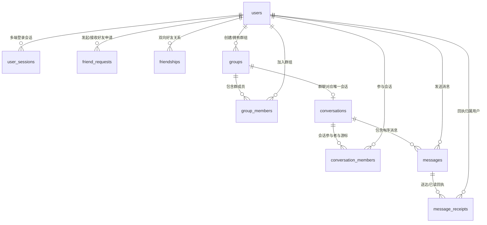

# 企业级即时通讯系统（Enterprise IM）项目目标与技术方案文档

> **文档定位**：本文件为 `/Users/niezidong/Projects/go` 项目的唯一权威目标规范与一期设计基线。所有编码、架构拆解、数据库迁移、测试验收与 Docker 部署均须严格遵循本文档，**必须实现真实可运行的业务功能，严禁使用 Mock 数据或假接口替代核心业务**。

---

## 一、项目目标与技术栈

构建一套**前后端分离、生产级可靠、可一键 Docker Compose 启动**的企业级即时通讯系统，支持多端登录、好友体系、单聊/群聊多媒体消息、四阶段消息可靠性保障、离线补偿、后台监控与千级 WebSocket 并发验证。

### 固定技术栈

| 层级 | 选型 | 职责说明 |
| :--- | :--- | :--- |
| **后端框架** | Go (1.22+) + Gin | RESTful API 与 WebSocket 升级接入 |
| **ORM / 数据访问** | GORM + MySQL 8.0 | 持久化存储、事务管理与防 N+1 预加载/联表查询 |
| **缓存与状态** | Redis 7 | 在线状态、多端会话路由、会话内 `seq` 生成、去重缓存、Token 黑名单 |
| **消息队列** | **Redis Streams** | 异步消息落库补偿、离线推送、群消息扇出广播与死信重试（无需额外部署 RabbitMQ） |
| **实时通信** | WebSocket (`gorilla/websocket` 或 `nhooyr/websocket`) | 全双工长连接、心跳保活、ACK 回执与实时推送 |
| **前端框架** | Vue 3 + TypeScript + Composition API | 现代企业级 IM Web 客户端 |
| **前端工程与 UI** | Vite + Element Plus + Pinia + Vue Router + Axios | 桌面优先三栏式专业 UI（兼容移动端基本布局） |
| **部署运维** | Docker + Docker Compose + Nginx | 单条命令启动全套服务（Go 后端 + Vue3/Nginx + MySQL + Redis） |

---

## 二、系统功能需求

### 1. 用户与认证模块
- 用户注册、登录、退出登录（单端退出 / 全部设备下线）。
- JWT 身份认证（Access Token 短有效期 + Refresh Token 轮换与持久化管理）。
- 用户头像上传与展示、昵称、个性签名管理。
- 修改密码（修改后使历史 Refresh Token 失效）。
- 用户搜索（按用户名/昵称精确与前缀模糊搜索，分页返回）。
- 用户在线状态管理（在线/离线、多端合并判定：任一终端在线即在线，全部终端断开才置离线）。
- 支持多端登录（Web / Desktop / Mobile，同账号多连接消息同步）。
- Token 过期自动无感刷新与并发刷新防竞态机制。

### 2. 好友管理模块
- 发送好友申请（附带验证消息，防止重复申请或向已是好友的用户发起申请）。
- 好友申请记录查询（收到的申请 / 发出的申请及处理状态）。
- 同意或拒绝好友申请（同意时在同一数据库事务内建立双向好友关系并初始化单聊会话）。
- 删除好友（解除关系，处理关联会话展示策略）。
- 好友备注修改（双向好友各自独立维护备注）。
- 好友列表与好友实时在线状态展示（上线/下线事件实时通知在线好友）。

### 3. 单聊模块
实现用户之间的一对一实时聊天。

- **消息类型**：
  - 文本消息（`text`）
  - 图片消息（`image`，真实文件上传与本地/静态资源访问，含宽高/缩略图元数据）
  - 文件消息（`file`，真实上传下载，含文件名、大小、MIME 类型）
  - 语音消息（`voice`，真实音频上传播放，含时长）
  - 撤回消息（`recall`，限定发送者本人且在可撤回时间窗内，同步更新展示与广播）
  - 系统通知消息（`system`，如“已添加为好友”“xxx 撤回了一条消息”）
- **核心能力要求**：
  - WebSocket 实时通信。
  - 消息持久化到 MySQL。
  - 明确区分并展示：**发送中 → 服务端确认（已发送）→ 接收方送达 → 接收方已读**。
  - 历史消息基于 `seq` 游标分页查询（避免深分页性能衰减）。
  - 离线消息存储与上线自动增量拉取补偿。
  - 断线自动重连（指数退避 + 抖动）。
  - 消息去重与幂等处理（`sender_id + client_msg_id`）。
  - 消息发送失败检测与手动/自动重试。

### 4. 群聊模块
- 创建群聊（选定初始成员，自动建立 `groups`、`group_members`、`conversations`、`conversation_members`）。
- 解散群聊（仅群主可操作，广播解散系统通知）。
- 邀请成员、移除成员、主动退出群聊（群主退出前需先转让群主或解散）。
- 群主转让与管理员角色权限控制（`owner` / `admin` / `member`）。
- 设置群名称、群头像与群公告（群公告变更产生系统通知）。
- 群成员列表查询（含群内角色、群昵称、在线状态）。
- 群消息实时广播（基于 Redis Streams 异步扇出或在线成员高效分发）与历史消息分页记录。

### 5. 消息可靠性模块（核心重点）
严禁简单地认为 WebSocket `WriteMessage` 成功就代表消息已经送达。必须实现**四阶段状态机**：

```text
[阶段 0] 发送中 (sending)          —— 客户端生成 client_msg_id 并入本地队列
   │  WS: msg.send
   ▼
[阶段 1] 服务端接收并持久化 (sent)  —— 幂等校验 -> 分配 Snowflake msg_id & 会话递增 seq -> 写入 MySQL -> 回发 WS: msg.ack
   │  推送给接收方在线端 / 写入离线待补队列
   ▼
[阶段 2] 接收方送达 (delivered)    —— 接收方客户端收到后回发 WS: msg.delivered_ack -> 更新回执与 delivered_seq -> 通知发送方
   │  接收方打开会话并滚动可见
   ▼
[阶段 3] 接收方已读 (read)         —— 接收方上报 WS/HTTP: msg.read_ack (conversation_id, last_read_seq) -> 清零未读并更新回执 -> 通知发送方
```

必须落实以下能力：
1. **全局唯一消息 ID**：服务端使用 Snowflake 算法生成 `int64/uint64` 全局唯一 `msg_id`。
2. **严格幂等去重**：`client_msg_id`（客户端 UUID）+ `sender_id` 构成数据库唯一约束与 Redis 短期去重缓存，重试请求直接返回已存在的 `msg_id` 与 `seq` 的 ACK，绝不重复落库。
3. **会话内严格保序**：每个会话通过 Redis `INCR conv:seq:{conversation_id}`（异常时回源 MySQL `MAX(seq)` 恢复）分配单调递增的 `seq`，客户端与历史查询严格按 `seq` 排序。
4. **断线重发与离线补偿**：客户端缓存未收到 `msg.ack` 的待确认消息，重连后按原 `client_msg_id` 重发；上线后携带各会话本地 `last_seq` 发起增量拉取（`seq > last_seq`），补齐断线期间所有遗漏消息。
5. **心跳保活与异常恢复**：客户端定时发送 `ping`，服务端回复 `pong` 并刷新读超时（`SetReadDeadline`）与 Redis 在线 TTL；超时立即清理僵尸连接，前端指数退避自动重连并同步状态。

### 6. 系统管理模块（Admin）
仅 `role = admin` 用户可访问：
- 用户管理（列表、搜索、详情、禁用/启用；禁用后立即强制踢下线并吊销其所有活跃 Session 与 WebSocket 连接）。
- 群聊管理（群列表、成员查看、强制解散）。
- 消息审计查询（按会话、发送者、关键词、时间范围分页查询）。
- 实时统计与运行监控：在线用户数、当前 WebSocket 总连接数、消息吞吐量/Redis Streams 积压情况、Go Runtime 内存/Goroutine 数、MySQL/Redis 健康状态。

---

## 三、完整技术方案与后端架构设计

### 1. 整体架构图

```text
                        ┌────────────────────────────────────┐
                        │     Vue3 + TS + Element Plus       │
                        │  Pinia Stores | Axios | WSClient   │
                        └─────────┬──────────────┬───────────┘
                                  │ HTTPS/REST   │ WSS (/ws)
                                  ▼              ▼
                        ┌────────────────────────────────────┐
                        │         Nginx (反向代理/静态资源)    │
                        └─────────┬──────────────┬───────────┘
                                  │              │
                                  ▼              ▼
┌─────────────────────────────────────────────────────────────────────────┐
│                         Go + Gin Backend Server                         │
│  ┌──────────────┐   ┌──────────────────┐   ┌─────────────────────────┐  │
│  │  HTTP API /  │   │  WebSocket Hub   │   │  MQ Consumer Workers    │  │
│  │  Middleware  │   │ (Sharded RWMutex │   │  (Redis Streams Group)  │  │
│  │ (JWT/Log/Err)│   │  + Send Channel) │   │  - 群消息异步广播        │  │
│  └──────┬───────┘   └────────┬─────────┘   │  - 离线补偿/状态通知      │  │
│         ▼                    │             └────────────┬────────────┘  │
│  ┌──────────────┐            │                          │               │
│  │  Controller  │            │                          │               │
│  └──────┬───────┘            │                          │               │
│         ▼                    ▼                          ▼               │
│  ┌───────────────────────────────────────────────────────────────────┐  │
│  │  Service Layer (Auth / Friend / Conversation / Message / Group)   │  │
│  └──────────────────────────────┬────────────────────────────────────┘  │
│                                 ▼                                       │
│  ┌───────────────────────────────────────────────────────────────────┐  │
│  │       Repository Layer (GORM + Transaction + Redis Client)        │  │
│  └──────────────────────┬───────────────────────────┬────────────────┘  │
└─────────────────────────┼───────────────────────────┼───────────────────┘
                          ▼                           ▼
               ┌────────────────────┐      ┌─────────────────────┐
               │     MySQL 8.0      │      │       Redis 7       │
               │ (核心业务与消息持久化)│      │ 在线状态/Seq/Streams │
               └────────────────────┘      └─────────────────────┘
```

### 2. 后端核心设计要点

1. **严格分层解耦**：`API/Router → Middleware → Controller → Service → Repository → Model`，Controller 仅负责参数绑定校验与响应封装，严禁堆砌业务逻辑。
2. **并发安全的 WebSocket Hub**：
   - 禁止裸用全局 `map`。采用**分片锁（Sharded Hub，如 32/64 分片，每个分片独立 `sync.RWMutex`）**维护 `userID -> map[connID]*Client`，支持单用户多端连接并发读写无锁竞争。
   - 每个 `Client` 配备独立的 `readPump` 与 `writePump` goroutine + 有界缓冲 `send chan []byte`（例如容量 256），写操作严格串行化在 `writePump` 中执行，慢消费者触发背压保护而非阻塞整个广播协程。
3. **Redis Streams 异步解耦**：
   - Stream Key：`im:stream:messages`（消息投递/群广播）、`im:stream:events`（好友申请、上下线通知、撤回与已读回执广播）。
   - 使用 Consumer Group（`XGROUP CREATE` + `XREADGROUP` + `XACK`）保障至少一次投递，配合幂等消费和超时 Pending 消息认领（`XAUTOCLAIM`），防止服务重启丢消息。
4. **数据库事务与防 N+1**：
   - 同意好友申请、创建群聊、发送消息写库并更新会话 `last_msg_*` 与成员未读数等复合写操作，必须包裹在 GORM 事务中。
   - 列表查询统一采用 `IN` 批量拉取或明确索引联表查询，严禁在 `for` 循环内发起单条 SQL。
5. **工程化规范**：
   - 统一响应结构：`{ "code": 0, "message": "ok", "data": ..., "request_id": "..." }`，集中维护业务错误码表。
   - 结构化日志：采用 `zap` 或标准库 `log/slog`，每条请求自动注入 `request_id`、`user_id`、`latency_ms`。
   - 配置管理：支持 `config.yaml` + 环境变量覆盖（如 Viper），区分开发/生产配置。
   - 优雅关闭（Graceful Shutdown）：监听 `SIGINT`/`SIGTERM`，按顺序停止接收新请求 → 通知并关闭 WebSocket 连接 → 排空 MQ 消费者与进行中 HTTP 请求 → 关闭 DB 与 Redis 连接。

### 3. WebSocket 通信协议规范（JSON Envelope）

所有双向帧采用统一信封：

```json
{
  "type": "msg.send | msg.ack | msg.push | msg.delivered_ack | msg.read_ack | msg.recall | presence.update | ping | pong | error",
  "req_id": "客户端请求追踪ID",
  "timestamp": 1764120000000,
  "data": {}
}
```

---

## 四、完整项目目录结构

```text
/Users/niezidong/Projects/go/
├── PROJECT_GOALS.md                 # 本文档：项目目标、架构方案与数据库设计
├── README.md                        # 项目启动、运维与验收说明
├── Makefile                         # 常用构建、测试、压测、Docker 快捷命令
├── .env.example                     # 环境变量模板
├── docker-compose.yml               # 一键启动全套服务（backend/frontend/mysql/redis）
├── docs/
│   ├── architecture.md              # 系统架构与消息可靠性详细设计
│   ├── api.md                       # REST API 与 WebSocket 协议文档
│   ├── er-diagram.md                # Mermaid 数据库 ER 图与表关系说明
│   └── test-report.md               # 单元/集成/1000并发压测报告
├── deploy/
│   ├── mysql/
│   │   └── init.sql                 # 完整初始化建表 SQL（含默认管理员种子）
│   └── nginx/
│       └── default.conf             # 前端静态托管 + /api 反代 + /ws WebSocket 反代
├── backend/
│   ├── Dockerfile
│   ├── go.mod
│   ├── go.sum
│   ├── cmd/
│   │   ├── server/
│   │   │   └── main.go              # 服务入口与优雅关闭编排
│   │   └── loadtest/
│   │       └── main.go              # 1000+ WS 客户端并发压测工具
│   ├── configs/
│   │   └── config.yaml              # 默认配置文件
│   ├── internal/
│   │   ├── api/
│   │   │   ├── router.go            # HTTP & WS 路由注册
│   │   │   └── ws_handler.go        # WebSocket 握手鉴权与升级入口
│   │   ├── config/
│   │   │   └── config.go            # YAML + ENV 配置加载
│   │   ├── controller/
│   │   │   ├── auth_controller.go
│   │   │   ├── user_controller.go
│   │   │   ├── friend_controller.go
│   │   │   ├── conversation_controller.go
│   │   │   ├── message_controller.go
│   │   │   ├── group_controller.go
│   │   │   ├── upload_controller.go
│   │   │   └── admin_controller.go
│   │   ├── service/
│   │   │   ├── auth_service.go
│   │   │   ├── user_service.go
│   │   │   ├── friend_service.go
│   │   │   ├── conversation_service.go
│   │   │   ├── message_service.go
│   │   │   ├── group_service.go
│   │   │   ├── presence_service.go
│   │   │   └── admin_service.go
│   │   ├── repository/
│   │   │   ├── db.go                # MySQL / GORM 连接与事务封装
│   │   │   ├── redis.go             # Redis 客户端初始化
│   │   │   ├── user_repo.go
│   │   │   ├── session_repo.go
│   │   │   ├── friend_repo.go
│   │   │   ├── conversation_repo.go
│   │   │   ├── message_repo.go
│   │   │   ├── receipt_repo.go
│   │   │   └── group_repo.go
│   │   ├── model/
│   │   │   ├── user.go
│   │   │   ├── user_session.go
│   │   │   ├── friendship.go
│   │   │   ├── friend_request.go
│   │   │   ├── conversation.go
│   │   │   ├── message.go
│   │   │   ├── message_receipt.go
│   │   │   └── group.go
│   │   ├── middleware/
│   │   │   ├── jwt.go               # JWT 鉴权 & Admin 角色校验
│   │   │   ├── logger.go            # 结构化访问日志 & request_id
│   │   │   ├── recovery.go          # Panic 捕获与统一错误返回
│   │   │   └── cors.go
│   │   ├── ws/
│   │   │   ├── hub.go               # 分片并发安全连接中心
│   │   │   ├── client.go            # 单连接 readPump / writePump / 心跳
│   │   │   ├── protocol.go          # WS 信封与事件类型定义
│   │   │   └── router.go            # WS 入站消息路由分发
│   │   ├── mq/
│   │   │   ├── producer.go          # Redis Streams 生产者
│   │   │   └── consumer.go          # Consumer Group 消费、ACK 与 Pending 补偿
│   │   └── pkg/
│   │       ├── errcode/             # 统一业务错误码与响应封装
│   │       ├── jwt/                 # Access/Refresh Token 签发与校验
│   │       ├── snowflake/           # 分布式唯一消息 ID 生成器
│   │       ├── logger/              # zap/slog 初始化
│   │       └── storage/             # 本地文件上传校验与存储
│   └── tests/                       # 集成测试与事务/并发测试用例
└── frontend/
    ├── Dockerfile
    ├── package.json
    ├── tsconfig.json
    ├── vite.config.ts
    ├── index.html
    └── src/
        ├── api/                     # Axios 封装与按模块拆分的 API 请求
        ├── assets/                  # 样式变量、黑白灰设计令牌与静态资源
        ├── components/              # 可复用细粒度组件（消息气泡、输入框、头像、上传器等）
        ├── composables/             # 组合式逻辑（重连状态、滚动分页、消息重试等）
        ├── layouts/                 # 三栏主布局（桌面端 + 移动端适配）
        ├── router/                  # 路由表与鉴权守卫（含 Admin 权限拦截）
        ├── stores/                  # Pinia Stores（auth/user/friend/conversation/message/group）
        ├── types/                   # TypeScript 模型、API 与 WS 协议类型定义
        ├── utils/                   # 独立 WSClient 管理类、时间格式化、UUID 等
        ├── views/
        │   ├── login/
        │   ├── register/
        │   ├── chat/
        │   ├── contacts/
        │   ├── groups/
        │   └── admin/
        └── App.vue
```

---

## 五、前端架构与 UI 设计规范

### 1. 架构硬性要求
- 严格使用 **Vue 3 + TypeScript + `<script setup>` Composition API**。
- **独立 `WSClient` 模块**（位于 `src/utils/wsClient.ts`）：统一管理建连、鉴权参数、心跳定时、指数退避重连、断线待发队列重发、事件订阅分发；**严禁在 `.vue` 组件里直接 `new WebSocket()`**。
- **Axios 客户端**（位于 `src/api/request.ts`）：统一注入 Access Token、拦截 401 自动触发单飞（Single-Flight）Refresh Token 刷新并重放挂起请求。
- **Pinia 状态管理**：拆分 `authStore`、`contactStore`、`conversationStore`、`messageStore`、`groupStore`；页面刷新后通过持久化凭证恢复用户信息、活跃会话并触发离线消息增量同步。
- **组件拆分**：聊天页按 `ConversationList`、`ConversationItem`、`ChatHeader`、`MessageList`、`MessageBubble`、`MessageComposer` 等合理拆分，杜绝上千行巨型单文件组件。

### 2. UI 视觉规范
- **风格参考**：微信 PC 版 / Slack / Telegram Desktop —— 现代企业级、克制、专业、信息密度适中。
- **色彩体系**：以 **纯白 (`#FFFFFF`)、浅灰 (`#F5F6F8` / `#ECEEF2`)、深灰 (`#4B5563`)、近黑 (`#111827`)** 为主色调，仅在必要状态点（在线绿、未读红、主操作强调色）做极简点缀。
- **严格禁止**：
  - 禁止使用渐变色（`linear-gradient` 等装饰背景）。
  - 禁止使用花哨装饰动画。
  - 禁止使用 Emoji 作为 UI 图标（统一使用 `@element-plus/icons-vue` 线性矢量图标）。
- **核心页面**：登录/注册页、三栏聊天主页（左导航 / 中会话列表 / 右聊天区）、联系人页、群聊管理页、管理后台页。

---

## 六、完整数据库设计

### 1. 核心表关系说明与 ER 概览



### 2. 三个核心 ID 的职责边界（必须严格区分）

| 字段 | 生成方 | 范围与特性 | 核心作用 |
| :--- | :--- | :--- | :--- |
| **`client_msg_id`** | 客户端（UUID v4 / ULID） | 发送者维度唯一 | 1. 发送中临时占位与状态更新匹配<br>2. 断线重发时配合 `UNIQUE(sender_id, client_msg_id)` 实现**服务端幂等去重** |
| **`id` (`msg_id`)** | 服务端（Snowflake） | 全局唯一、大致趋势递增 | 全局消息主键、回执关联键、撤回/审计引用键 |
| **`seq`** | 服务端（会话级单调递增） | **同一 `conversation_id` 内严格连续递增** | 1. 保证同一会话内多端渲染顺序绝对一致<br>2. 支撑 `seq < cursor` 高性能历史分页与 `seq > last_seq` 离线增量补偿<br>3. 支撑 `last_delivered_seq` / `last_read_seq` 水位线未读统计 |

### 3. 完整建表 SQL（MySQL 8.0，InnoDB，`utf8mb4`）

```sql
CREATE DATABASE IF NOT EXISTS `enterprise_im`
  DEFAULT CHARACTER SET utf8mb4
  DEFAULT COLLATE utf8mb4_0900_ai_ci;

USE `enterprise_im`;

-- 1. 用户表
CREATE TABLE `users` (
  `id` BIGINT UNSIGNED NOT NULL AUTO_INCREMENT COMMENT '用户ID',
  `username` VARCHAR(64) NOT NULL COMMENT '登录用户名（唯一）',
  `password_hash` VARCHAR(255) NOT NULL COMMENT 'bcrypt 密码哈希',
  `nickname` VARCHAR(64) NOT NULL COMMENT '展示昵称',
  `avatar_url` VARCHAR(512) NOT NULL DEFAULT '' COMMENT '头像地址',
  `signature` VARCHAR(255) NOT NULL DEFAULT '' COMMENT '个性签名',
  `role` ENUM('user', 'admin') NOT NULL DEFAULT 'user' COMMENT '用户角色',
  `status` TINYINT NOT NULL DEFAULT 1 COMMENT '状态：1正常 0禁用',
  `last_online_at` DATETIME(3) NULL DEFAULT NULL COMMENT '最后在线时间',
  `created_at` DATETIME(3) NOT NULL DEFAULT CURRENT_TIMESTAMP(3),
  `updated_at` DATETIME(3) NOT NULL DEFAULT CURRENT_TIMESTAMP(3) ON UPDATE CURRENT_TIMESTAMP(3),
  PRIMARY KEY (`id`),
  UNIQUE KEY `uk_users_username` (`username`),
  KEY `idx_users_nickname` (`nickname`),
  KEY `idx_users_status_created` (`status`, `created_at`)
) ENGINE=InnoDB DEFAULT CHARSET=utf8mb4 COMMENT='用户表';

-- 2. 用户多端会话表（Refresh Token 与多端设备管理）
CREATE TABLE `user_sessions` (
  `id` BIGINT UNSIGNED NOT NULL AUTO_INCREMENT COMMENT '会话记录ID',
  `user_id` BIGINT UNSIGNED NOT NULL COMMENT '用户ID',
  `device_id` VARCHAR(128) NOT NULL COMMENT '客户端设备唯一标识',
  `device_type` ENUM('web', 'desktop', 'mobile') NOT NULL DEFAULT 'web' COMMENT '终端类型',
  `refresh_token_hash` CHAR(64) NOT NULL COMMENT 'Refresh Token SHA-256 哈希',
  `access_jti` VARCHAR(64) NOT NULL COMMENT '当前有效 Access Token JTI',
  `ip_address` VARCHAR(64) NOT NULL DEFAULT '' COMMENT '登录IP',
  `user_agent` VARCHAR(512) NOT NULL DEFAULT '' COMMENT 'User-Agent',
  `expires_at` DATETIME(3) NOT NULL COMMENT 'Refresh Token 过期时间',
  `revoked_at` DATETIME(3) NULL DEFAULT NULL COMMENT '主动注销或强制下线时间',
  `last_active_at` DATETIME(3) NOT NULL DEFAULT CURRENT_TIMESTAMP(3),
  `created_at` DATETIME(3) NOT NULL DEFAULT CURRENT_TIMESTAMP(3),
  `updated_at` DATETIME(3) NOT NULL DEFAULT CURRENT_TIMESTAMP(3) ON UPDATE CURRENT_TIMESTAMP(3),
  PRIMARY KEY (`id`),
  UNIQUE KEY `uk_sessions_refresh_hash` (`refresh_token_hash`),
  KEY `idx_sessions_user_device` (`user_id`, `device_id`),
  KEY `idx_sessions_user_revoked_exp` (`user_id`, `revoked_at`, `expires_at`)
) ENGINE=InnoDB DEFAULT CHARSET=utf8mb4 COMMENT='用户多端登录会话表';

-- 3. 好友申请表
CREATE TABLE `friend_requests` (
  `id` BIGINT UNSIGNED NOT NULL AUTO_INCREMENT COMMENT '申请ID',
  `from_user_id` BIGINT UNSIGNED NOT NULL COMMENT '申请人ID',
  `to_user_id` BIGINT UNSIGNED NOT NULL COMMENT '目标用户ID',
  `message` VARCHAR(255) NOT NULL DEFAULT '' COMMENT '验证消息',
  `status` ENUM('pending', 'accepted', 'rejected', 'canceled') NOT NULL DEFAULT 'pending' COMMENT '处理状态',
  `handled_at` DATETIME(3) NULL DEFAULT NULL COMMENT '处理时间',
  `created_at` DATETIME(3) NOT NULL DEFAULT CURRENT_TIMESTAMP(3),
  `updated_at` DATETIME(3) NOT NULL DEFAULT CURRENT_TIMESTAMP(3) ON UPDATE CURRENT_TIMESTAMP(3),
  PRIMARY KEY (`id`),
  KEY `idx_fr_to_status_created` (`to_user_id`, `status`, `created_at` DESC),
  KEY `idx_fr_from_to_status` (`from_user_id`, `to_user_id`, `status`)
) ENGINE=InnoDB DEFAULT CHARSET=utf8mb4 COMMENT='好友申请记录表';

-- 4. 好友关系表（双向两条记录存储，独立支持备注且避免 OR 扫描）
CREATE TABLE `friendships` (
  `id` BIGINT UNSIGNED NOT NULL AUTO_INCREMENT COMMENT '关系ID',
  `user_id` BIGINT UNSIGNED NOT NULL COMMENT '归属用户ID',
  `friend_id` BIGINT UNSIGNED NOT NULL COMMENT '好友用户ID',
  `remark` VARCHAR(64) NOT NULL DEFAULT '' COMMENT '好友备注',
  `status` TINYINT NOT NULL DEFAULT 1 COMMENT '1正常好友 0已删除',
  `created_at` DATETIME(3) NOT NULL DEFAULT CURRENT_TIMESTAMP(3),
  `updated_at` DATETIME(3) NOT NULL DEFAULT CURRENT_TIMESTAMP(3) ON UPDATE CURRENT_TIMESTAMP(3),
  PRIMARY KEY (`id`),
  UNIQUE KEY `uk_friendships_pair` (`user_id`, `friend_id`),
  KEY `idx_friendships_user_status` (`user_id`, `status`),
  KEY `idx_friendships_friend_status` (`friend_id`, `status`)
) ENGINE=InnoDB DEFAULT CHARSET=utf8mb4 COMMENT='好友关系表';

-- 5. 群组表
CREATE TABLE `groups` (
  `id` BIGINT UNSIGNED NOT NULL AUTO_INCREMENT COMMENT '群组ID',
  `name` VARCHAR(100) NOT NULL COMMENT '群名称',
  `avatar_url` VARCHAR(512) NOT NULL DEFAULT '' COMMENT '群头像',
  `owner_id` BIGINT UNSIGNED NOT NULL COMMENT '群主用户ID',
  `announcement` TEXT NULL COMMENT '群公告',
  `max_members` INT UNSIGNED NOT NULL DEFAULT 500 COMMENT '群人数上限',
  `status` ENUM('active', 'disbanded') NOT NULL DEFAULT 'active' COMMENT '群状态',
  `created_at` DATETIME(3) NOT NULL DEFAULT CURRENT_TIMESTAMP(3),
  `updated_at` DATETIME(3) NOT NULL DEFAULT CURRENT_TIMESTAMP(3) ON UPDATE CURRENT_TIMESTAMP(3),
  PRIMARY KEY (`id`),
  KEY `idx_groups_owner` (`owner_id`),
  KEY `idx_groups_status_created` (`status`, `created_at` DESC)
) ENGINE=InnoDB DEFAULT CHARSET=utf8mb4 COMMENT='群组表';

-- 6. 群成员表
CREATE TABLE `group_members` (
  `id` BIGINT UNSIGNED NOT NULL AUTO_INCREMENT COMMENT '记录ID',
  `group_id` BIGINT UNSIGNED NOT NULL COMMENT '群组ID',
  `user_id` BIGINT UNSIGNED NOT NULL COMMENT '成员用户ID',
  `role` ENUM('owner', 'admin', 'member') NOT NULL DEFAULT 'member' COMMENT '群内角色',
  `nickname_in_group` VARCHAR(64) NOT NULL DEFAULT '' COMMENT '群内昵称',
  `joined_at` DATETIME(3) NOT NULL DEFAULT CURRENT_TIMESTAMP(3),
  `updated_at` DATETIME(3) NOT NULL DEFAULT CURRENT_TIMESTAMP(3) ON UPDATE CURRENT_TIMESTAMP(3),
  PRIMARY KEY (`id`),
  UNIQUE KEY `uk_gm_group_user` (`group_id`, `user_id`),
  KEY `idx_gm_user_group` (`user_id`, `group_id`)
) ENGINE=InnoDB DEFAULT CHARSET=utf8mb4 COMMENT='群成员表';

-- 7. 会话表（统一抽象单聊与群聊）
CREATE TABLE `conversations` (
  `id` BIGINT UNSIGNED NOT NULL AUTO_INCREMENT COMMENT '会话ID',
  `type` ENUM('single', 'group') NOT NULL COMMENT '会话类型',
  `direct_key` VARCHAR(64) NULL DEFAULT NULL COMMENT '单聊唯一键：min(u1,u2):max(u1,u2)，群聊为NULL',
  `group_id` BIGINT UNSIGNED NULL DEFAULT NULL COMMENT '群聊关联群ID，单聊为NULL',
  `last_msg_id` BIGINT UNSIGNED NOT NULL DEFAULT 0 COMMENT '最后一条消息Snowflake ID',
  `last_seq` BIGINT UNSIGNED NOT NULL DEFAULT 0 COMMENT '当前会话最大序号seq',
  `last_msg_preview` VARCHAR(255) NOT NULL DEFAULT '' COMMENT '最后一条消息预览文案',
  `last_msg_at` DATETIME(3) NULL DEFAULT NULL COMMENT '最后一条消息时间',
  `created_at` DATETIME(3) NOT NULL DEFAULT CURRENT_TIMESTAMP(3),
  `updated_at` DATETIME(3) NOT NULL DEFAULT CURRENT_TIMESTAMP(3) ON UPDATE CURRENT_TIMESTAMP(3),
  PRIMARY KEY (`id`),
  UNIQUE KEY `uk_conv_direct_key` (`direct_key`),
  UNIQUE KEY `uk_conv_group_id` (`group_id`),
  KEY `idx_conv_last_msg_at` (`last_msg_at` DESC)
) ENGINE=InnoDB DEFAULT CHARSET=utf8mb4 COMMENT='会话表';

-- 8. 会话成员表（承载未读数、送达/已读水位线与会话排序）
CREATE TABLE `conversation_members` (
  `id` BIGINT UNSIGNED NOT NULL AUTO_INCREMENT COMMENT '记录ID',
  `conversation_id` BIGINT UNSIGNED NOT NULL COMMENT '会话ID',
  `user_id` BIGINT UNSIGNED NOT NULL COMMENT '用户ID',
  `last_delivered_seq` BIGINT UNSIGNED NOT NULL DEFAULT 0 COMMENT '该用户已送达最大seq',
  `last_read_seq` BIGINT UNSIGNED NOT NULL DEFAULT 0 COMMENT '该用户已读最大seq',
  `unread_count` INT UNSIGNED NOT NULL DEFAULT 0 COMMENT '未读消息数',
  `is_pinned` TINYINT(1) NOT NULL DEFAULT 0 COMMENT '是否置顶',
  `is_muted` TINYINT(1) NOT NULL DEFAULT 0 COMMENT '是否免打扰',
  `is_visible` TINYINT(1) NOT NULL DEFAULT 1 COMMENT '会话列表是否可见',
  `joined_at` DATETIME(3) NOT NULL DEFAULT CURRENT_TIMESTAMP(3),
  `updated_at` DATETIME(3) NOT NULL DEFAULT CURRENT_TIMESTAMP(3) ON UPDATE CURRENT_TIMESTAMP(3),
  PRIMARY KEY (`id`),
  UNIQUE KEY `uk_cm_conv_user` (`conversation_id`, `user_id`),
  KEY `idx_cm_user_visible_updated` (`user_id`, `is_visible`, `is_pinned` DESC, `updated_at` DESC)
) ENGINE=InnoDB DEFAULT CHARSET=utf8mb4 COMMENT='会话成员表';

-- 9. 消息表（核心大表：按 conversation_id + seq 强索引优化）
CREATE TABLE `messages` (
  `id` BIGINT UNSIGNED NOT NULL COMMENT '服务端生成的 Snowflake 全局唯一消息ID',
  `conversation_id` BIGINT UNSIGNED NOT NULL COMMENT '所属会话ID',
  `seq` BIGINT UNSIGNED NOT NULL COMMENT '会话内单调递增序号',
  `sender_id` BIGINT UNSIGNED NOT NULL COMMENT '发送者用户ID（系统消息为0）',
  `client_msg_id` VARCHAR(64) NOT NULL COMMENT '客户端幂等消息ID',
  `msg_type` ENUM('text', 'image', 'file', 'voice', 'recall', 'system') NOT NULL COMMENT '消息类型',
  `content` TEXT NOT NULL COMMENT '消息文本内容或展示摘要',
  `extra` JSON NULL COMMENT '扩展元数据（文件URL/大小/时长/被撤回msg_id等）',
  `status` ENUM('normal', 'recalled') NOT NULL DEFAULT 'normal' COMMENT '消息状态',
  `recalled_at` DATETIME(3) NULL DEFAULT NULL COMMENT '撤回时间',
  `created_at` DATETIME(3) NOT NULL DEFAULT CURRENT_TIMESTAMP(3),
  PRIMARY KEY (`id`),
  UNIQUE KEY `uk_msg_conv_seq` (`conversation_id`, `seq`),
  UNIQUE KEY `uk_msg_sender_client` (`sender_id`, `client_msg_id`),
  KEY `idx_msg_conv_created` (`conversation_id`, `created_at` DESC),
  KEY `idx_msg_sender_created` (`sender_id`, `created_at` DESC)
) ENGINE=InnoDB DEFAULT CHARSET=utf8mb4 COMMENT='消息表';

-- 10. 消息送达与已读回执表
CREATE TABLE `message_receipts` (
  `id` BIGINT UNSIGNED NOT NULL AUTO_INCREMENT COMMENT '回执ID',
  `message_id` BIGINT UNSIGNED NOT NULL COMMENT '消息Snowflake ID',
  `conversation_id` BIGINT UNSIGNED NOT NULL COMMENT '所属会话ID',
  `seq` BIGINT UNSIGNED NOT NULL COMMENT '对应消息seq',
  `user_id` BIGINT UNSIGNED NOT NULL COMMENT '接收方用户ID',
  `status` ENUM('sent', 'delivered', 'read') NOT NULL DEFAULT 'sent' COMMENT '回执状态',
  `delivered_at` DATETIME(3) NULL DEFAULT NULL COMMENT '送达时间',
  `read_at` DATETIME(3) NULL DEFAULT NULL COMMENT '已读时间',
  `created_at` DATETIME(3) NOT NULL DEFAULT CURRENT_TIMESTAMP(3),
  `updated_at` DATETIME(3) NOT NULL DEFAULT CURRENT_TIMESTAMP(3) ON UPDATE CURRENT_TIMESTAMP(3),
  PRIMARY KEY (`id`),
  UNIQUE KEY `uk_receipt_msg_user` (`message_id`, `user_id`),
  KEY `idx_receipt_conv_user_seq` (`conversation_id`, `user_id`, `seq`),
  KEY `idx_receipt_conv_user_status` (`conversation_id`, `user_id`, `status`)
) ENGINE=InnoDB DEFAULT CHARSET=utf8mb4 COMMENT='消息送达和已读回执表';
```

### 4. 数据量增长与查询优化策略
1. **游标分页杜绝深分页**：历史消息一律使用 `WHERE conversation_id = ? AND seq < ? ORDER BY seq DESC LIMIT 20`，精准命中 `uk_msg_conv_seq` 索引，无需 `OFFSET`。
2. **离线补偿查询**：重连后基于 `WHERE conversation_id = ? AND seq > ? ORDER BY seq ASC LIMIT 100` 批量拉取。
3. **大数据量演进预留**：`messages` 与 `message_receipts` 天然具备按 `conversation_id` 哈希分表或按 `created_at` 按月归档冷热分离的主键与索引结构（Snowflake ID 本身含时间戳，无需自增锁争用）。
4. **避免 N+1 查询**：拉取会话列表时先查当前用户的 `conversation_members` JOIN `conversations`，再将涉及的对端 `user_id` / `group_id` 收集为切片执行单次 `IN` 批量查询并拼装在线状态（Redis `MGET`/`Pipeline`）。
5. **群聊回执写放大控制**：单聊逐条更新 `message_receipts` 并同步推进 `conversation_members` 水位线；大群聊以 `conversation_members.last_delivered_seq` / `last_read_seq` 水位线为主，同时支持按需查询已读/未读成员明细。

---

## 七、部署要求（Docker Compose 一键启动）

项目采用 **Redis Streams** 作为消息队列，Docker Compose 编排以下 4 个核心服务：
1. `mysql`（MySQL 8.0，自动挂载 `deploy/mysql/init.sql` 与数据卷，配置 `healthcheck`）
2. `redis`（Redis 7，开启 AOF 持久化，配置 `healthcheck`）
3. `backend`（Go 多阶段构建镜像，依赖 `mysql` & `redis` 健康后启动，挂载上传文件卷）
4. `frontend`（Node 构建 Vue3 产物 + Nginx 托管，统一反代 `/api`、`/uploads` 与 `/ws` 升级头）

交付物包含：`backend/Dockerfile`、`frontend/Dockerfile`、`docker-compose.yml`、`.env.example`、`deploy/mysql/init.sql`、`deploy/nginx/default.conf`、`README.md`。验收目标：**执行 `docker compose up -d --build` 一条命令即可拉起完整可用系统**。

---

## 八、测试与千级并发压测要求

### 1. 必须覆盖的自动化测试
1. 用户认证单元测试（注册、登录、密码修改、Token 刷新与吊销、禁用踢下线）。
2. 好友管理测试（申请、防重、同意事务建会话、拒绝、删除、备注）。
3. 消息发送测试（文本/媒体元数据、单聊持久化、撤回时限与权限校验）。
4. 消息幂等测试（相同 `client_msg_id` 并发重发 10 次只入库 1 条且返回一致 `msg_id`/`seq`）。
5. WebSocket 并发连接测试（多端同账号注册/断开并发安全，`go test -race` 零数据竞争）。
6. 群聊广播测试（创建、权限控制、群消息全员送达、移出成员后不再收到新消息）。
7. 消息断线重连与离线补偿测试（断网期间消息不丢，上线后按 `seq` 补全且无重复）。
8. 数据库事务回滚测试（模拟中途失败确保无脏数据残留）。
9. 前端核心交互测试（Vitest 测试 Pinia Store 增量更新、WSClient 重连与未读数逻辑）。

### 2. 千级 WebSocket 并发压测（`backend/cmd/loadtest`）
- 模拟 **1000 个真实 WebSocket 客户端** 同时建连并保持心跳。
- 多用户并发向单聊/群聊持续发送带唯一 `client_msg_id` 的消息。
- 压测脚本自动统计并断言：
  - 消息丢失率 = `0`
  - 消息重复率 = `0`
  - 同会话内接收到的 `seq` 严格递增（无乱序）
  - 全部客户端上线与断开后，系统统计的在线用户数与连接数完全准确归零
- 输出实测指标与报告至 `docs/test-report.md`。

---

## 九、严格开发阶段与自检门槛

开发必须严格按以下 11 个阶段顺序推进，**每个阶段完成后必须进行编译、运行与自检，未通过禁止跳入下一阶段**：

| 阶段 | 目标与交付物 | 阶段自检门槛 |
| :--- | :--- | :--- |
| **第一阶段** | 需求分析与技术架构设计 | 确认本文档、`docs/architecture.md` 与接口/WS 协议约定 |
| **第二阶段** | 数据库设计与 ER 图 | `deploy/mysql/init.sql` 在真实 MySQL 8.0 成功导入无报错，`docs/er-diagram.md` 完备 |
| **第三阶段** | 后端基础工程搭建 | Go 工程分层就绪、配置/日志/错误码/MySQL/Redis/健康检查/优雅关闭全部跑通 |
| **第四阶段** | 用户认证与好友管理 | 注册/登录/多端 Refresh/改密/搜人/好友全流程 API 可调且单测通过 |
| **第五阶段** | WebSocket 实时通信 | 分片并发安全 Hub、JWT 握手鉴权、心跳超时踢除、多端在线状态同步通过 `-race` 测试 |
| **第六阶段** | 单聊与群聊核心业务 | 6 类消息（含真实文件上传）、单聊/群聊管理、权限校验与实时广播跑通 |
| **第七阶段** | 消息可靠性与离线补偿 | 四阶段 ACK 状态机、Snowflake+`seq` 排序、幂等去重、Redis Streams 消费与断线补偿验证通过 |
| **第八阶段** | Vue3 前端开发 | 黑白灰企业级三栏 UI、独立 `WSClient`、Pinia 状态恢复、全部业务页与管理后台完成 |
| **第九阶段** | 前后端全链路联调 | 多账号/多浏览器实测注册→加好友→单聊/群聊→上传图片文件→撤回→断网重连→后台监控 |
| **第十阶段** | 自动化测试、千人压测与优化 | 全套单测/集成测试 + `go test -race` 通过，1000 WS 客户端压测达成零丢/零重/保序并出报告 |
| **第十一阶段** | Docker 部署与完整文档 | `docker compose up -d --build` 一键冷启动可用，补齐 API 文档、架构文档与 README |

---

## 十、最终交付标准与严禁项

### 交付清单
1. 完整可编译运行的 Go 后端源码（`backend/`）
2. 完整可编译运行的 Vue3 + TypeScript 前端源码（`frontend/`）
3. 完整 MySQL 建表与初始化 SQL（`deploy/mysql/init.sql`）
4. Docker 一键部署配置（`Dockerfile`、`docker-compose.yml`、`.env.example`、`nginx`）
5. API 与 WebSocket 协议文档（`docs/api.md`）
6. 项目架构说明（`docs/architecture.md`）
7. 数据库 ER 图（`docs/er-diagram.md`）
8. 测试与 1000 并发压测报告（`docs/test-report.md`）
9. 项目运行说明（`README.md`）

### 绝对红线（严禁项）
- 禁止使用伪代码或 `TODO` 占位核心逻辑。
- 禁止使用假接口或 Mock 数据替代真实 MySQL/Redis/WebSocket 业务。
- 禁止将所有业务堆砌在单个文件或 Controller 中。
- 禁止忽略错误返回或忽略 WebSocket / 共享 Map 的并发安全保护。
- 禁止只画前端 UI 而不联通真实后端业务。

### 最终基本验收标准
一条 `docker compose up -d --build` 成功启动后，使用真实浏览器完成：**注册两个以上账号 → 多端登录 → 互加好友 → 实时单聊（含文本/图片/文件/语音/撤回/送达与已读回执）→ 建群与群聊广播 → 断网重连后离线消息无丢失无重复补齐 → 管理后台查看在线统计并禁用账号实时踢下线 → 刷新页面数据完整持久化**。
