# Enterprise IM（企业即时通讯系统）

Enterprise IM 是一个前后端分离的企业级即时通讯系统，包含完整的 Go 实时消息后端与 Vue 3 Web 客户端，全部业务均接入真实的 MySQL 8.0、Redis 7 与 WebSocket 服务。

系统支持多端登录与会话管理、好友体系、单聊与群聊（含文本/图片/文件/语音/撤回）、基于 Snowflake 与会话 `seq` 的四阶段消息可靠性状态机（发送中 → 已发送 → 已送达 → 已读）、断线自动重连与离线增量补偿，以及平台管理后台（实时运行监控、用户与设备会话管控、群组监管、不可变消息审计）。

---

## 核心能力

- **账号与多端认证**：支持注册、登录、多端设备会话管理（`web` / `desktop` / `mobile`）、Access/Refresh JWT 双令牌轮换、Token 黑名单校验，以及单端/全端退出与改密踢下线。
- **好友与联系人**：支持按用户名/昵称精确或前缀搜索用户、发送与处理好友申请（同意/拒绝/取消）、双向好友关系与独立备注维护、好友实时上下线状态推送。
- **单聊与群聊**：支持文本、图片（自动生成缩略图）、文件、语音（解析时长）及消息撤回（可配置时间窗）与系统通知；支持创建群聊、群成员与角色管理（群主/管理员/成员）、群公告、转让与解散。
- **消息可靠性与离线补偿**：
  - 客户端幂等标识 `client_msg_id` + 服务端全局 Snowflake `msg_id` + 会话内单调递增 `seq`。
  - 四阶段回执流转（`sending` → `sent` → `delivered` → `read`），基于 `seq` 游标分页与断线重连后按 `last_seq` 增量拉取。
  - 64 分片并发安全 WebSocket Hub + Redis Streams（`im:stream:messages` / `im:stream:events`）异步投递、Pending 认领与死信保护。
- **管理控制台（Admin）**：面向 `admin` 角色提供系统运行监控（在线用户数、WS 连接数、Streams 积压、Go Runtime 与 MySQL/Redis 健康探活）、用户禁用与强制踢下线、群组强制解散与消息审计查询。

---

## 技术栈

| 层级 | 技术选型 | 说明 |
| --- | --- | --- |
| **后端服务** | Go + Gin | RESTful API（`/api/v1`）、健康探活（`/healthz`）、WebSocket 接入（`/ws`） |
| **持久层** | GORM + MySQL 8.0 | 核心业务与 12 张 InnoDB 表（含用户、会话、消息、回执、上传资产与审计日志） |
| **缓存与消息队列** | Redis 7（go-redis） | 在线租约与路由、会话 `seq` 分配、幂等去重、JTI 黑名单、Redis Streams 消费组 |
| **实时通信** | `gorilla/websocket` | 64 分片 Hub、独立 `readPump` / `writePump`、有界发送队列与心跳保活 |
| **前端框架** | Vue 3 + TypeScript | `<script setup>` Composition API、Pinia 状态管理、Vue Router、Axios（单飞刷新 Token） |
| **前端 UI 与工程** | Element Plus + Vite | iOS 风格分组卡片与三栏自适应布局，独立 `WSClient` 模块管理建连与指数退避重连 |

---

## 界面预览

以下截图均截取自当前仓库在本地真实运行的前端（`http://127.0.0.1:5173/`）与后端服务（桌面端 1280×800，移动端 390×844）。

### 1. 登录认证

采用居中卡片与浅灰背景设计，桌面端与移动端自适应居中展示，未登录访问受保护路由时自动跳转至 `/login`。

| 桌面端（`/login`） | 移动端（`/login`） |
| :---: | :---: |
| 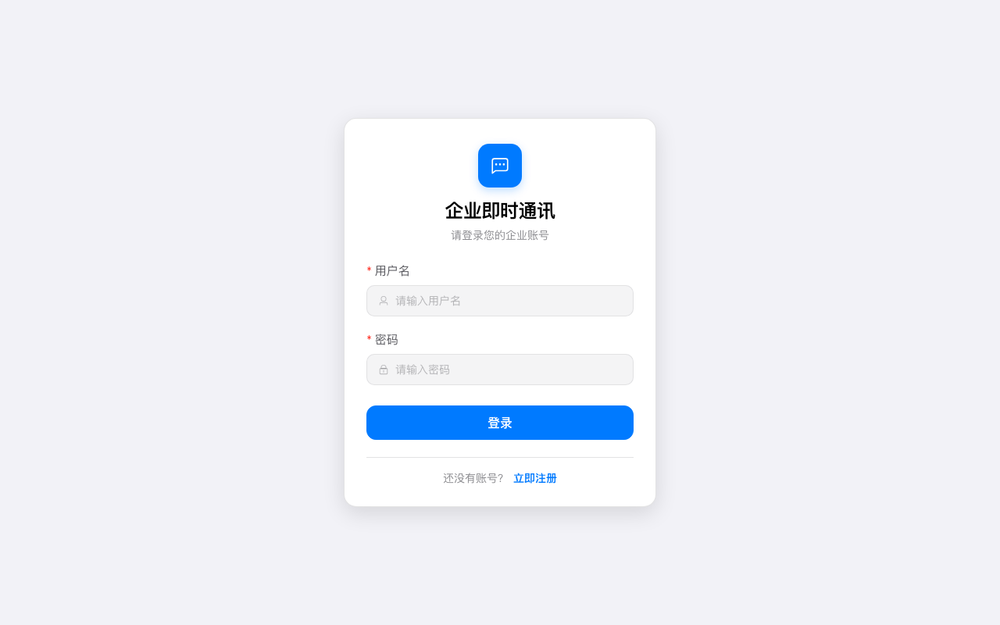 | 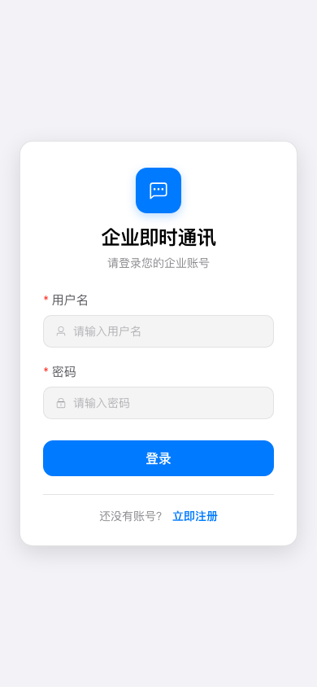 |

### 2. 消息工作区

桌面端采用「左侧导航栏 + 中间会话列表 + 右侧聊天区」三栏布局，顶部显示实时 WebSocket 连接状态；聊天区支持多类型消息输入（文本、图片、文件、语音录制/音频上传）及消息状态展示，移动端自动切换为「会话列表 → 聊天详情」单栏导航。

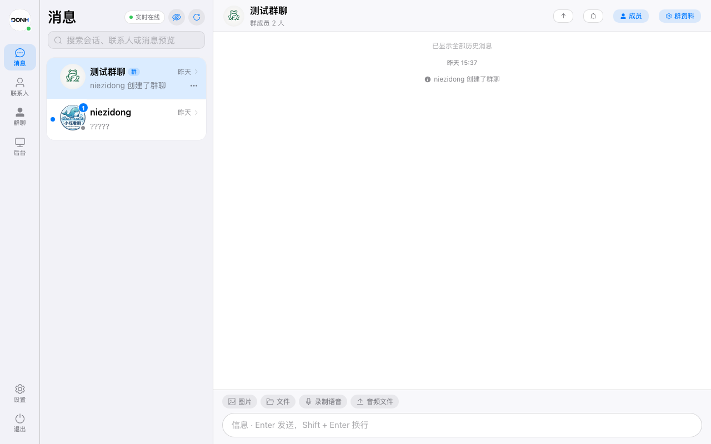

移动端会话列表底部提供导航栏，点击会话可进入全屏聊天窗口：

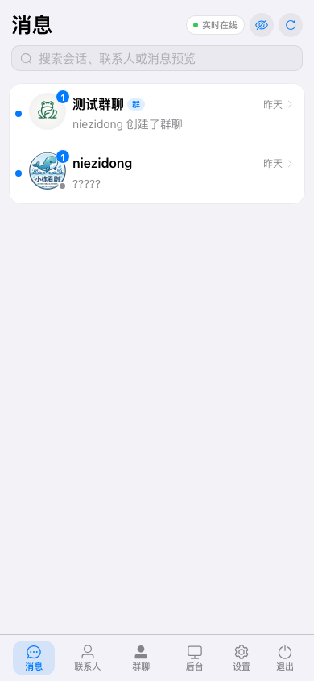

### 3. 联系人与好友申请

支持站内用户检索、发起好友申请、按「收到的申请 / 发出的申请」与处理状态筛选，并可直接从好友列表发起单聊会话。

| 桌面端（`/contacts`） | 移动端（`/contacts`） |
| :---: | :---: |
| 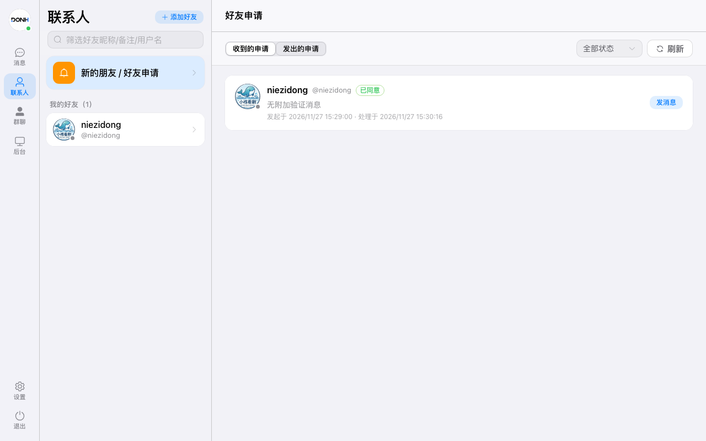 | 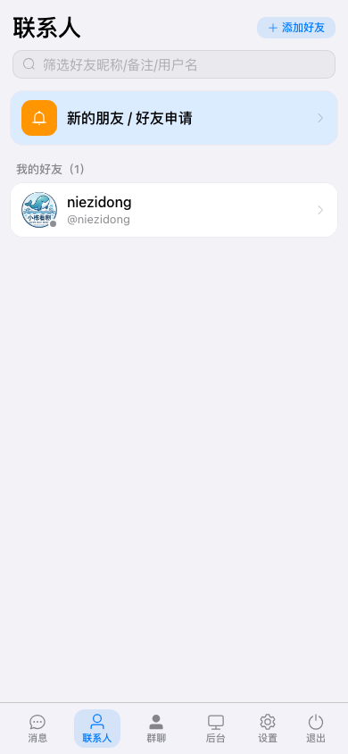 |

### 4. 群聊管理

支持按「全部 / 正常 / 已解散」分段筛选群聊、弹出新建群聊面板、查看群成员角色与在线状态、管理群资料与一键进入群聊窗口。

| 桌面端（`/groups`） | 移动端（`/groups`） |
| :---: | :---: |
| 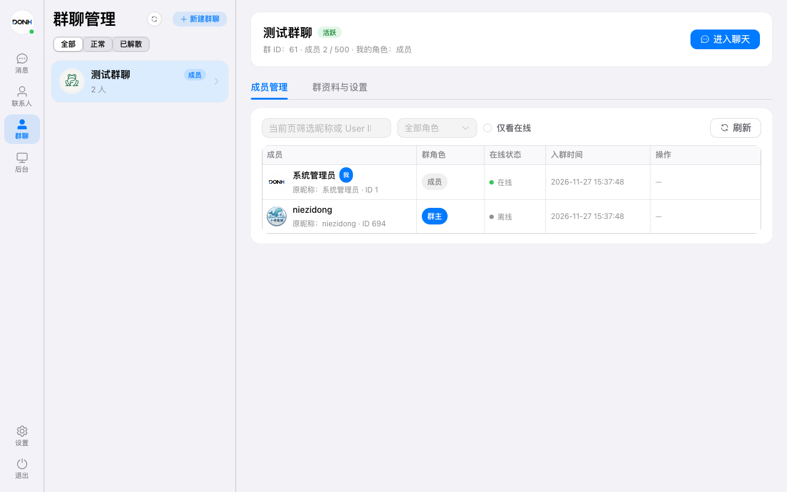 | 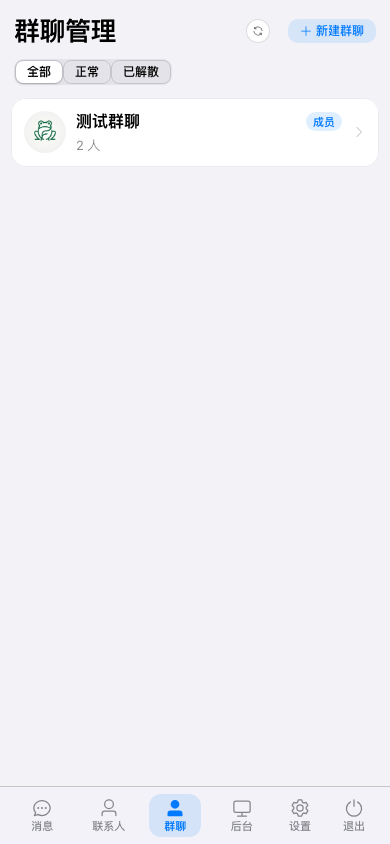 |

### 5. 管理控制台（Admin）

平台管理员账号（`role = admin`）可通过左侧导航进入 `/admin` 控制台，包含运行监控、用户管理、群组监管与消息审计四个子视图；窄屏下数据表格自动切换为卡片列表展示。

- **系统运行监控（`/admin/overview`）**：实时展示在线用户数、WebSocket 连接数、消息吞吐、Redis Streams 消费组与 Pending 积压、Go Runtime 指标及 MySQL/Redis 健康探活延迟。

| 桌面端（`/admin/overview`） | 移动端（`/admin/overview`） |
| :---: | :---: |
| 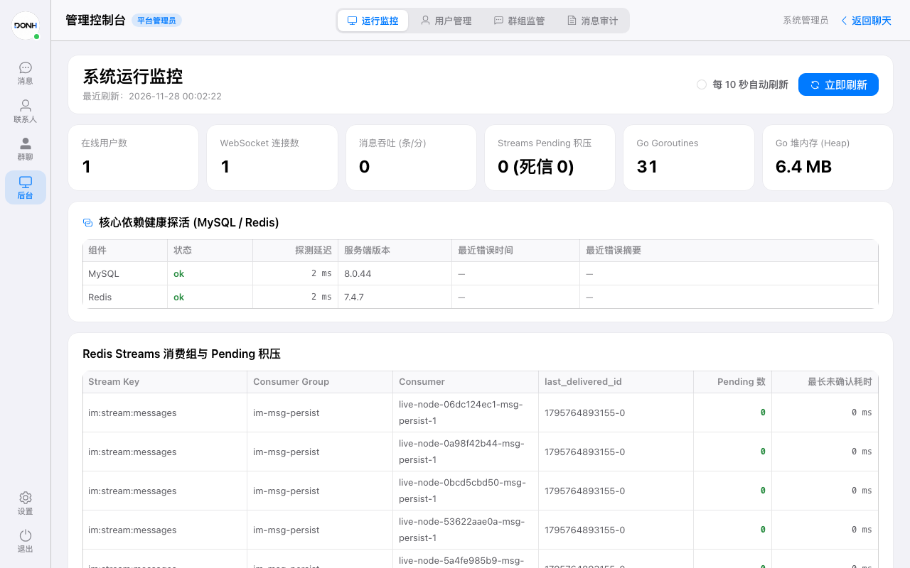 | 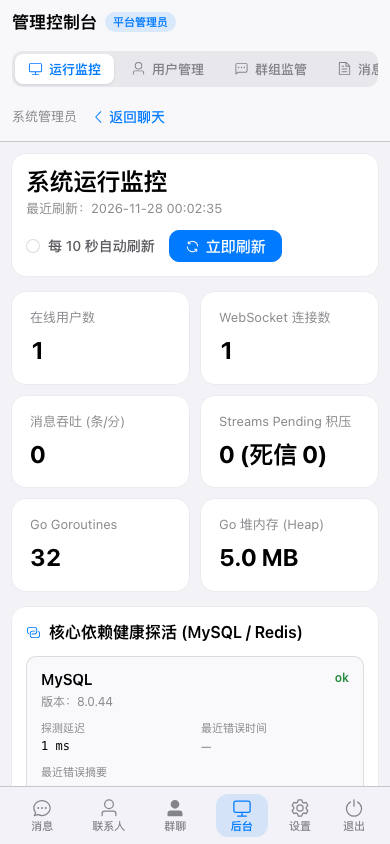 |

- **用户管理（`/admin/users`）**：支持按用户名/昵称/ID 与状态、角色检索账号，查看设备会话详情、执行禁用/启用与单端/全端强制踢下线。

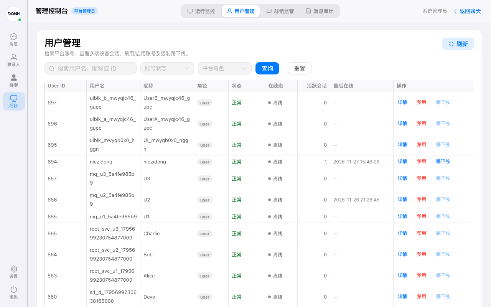

- **群组监管（`/admin/groups`）**：检索全平台群聊、查看成员与会话末序号、跳转对应消息审计或执行合规强制解散。

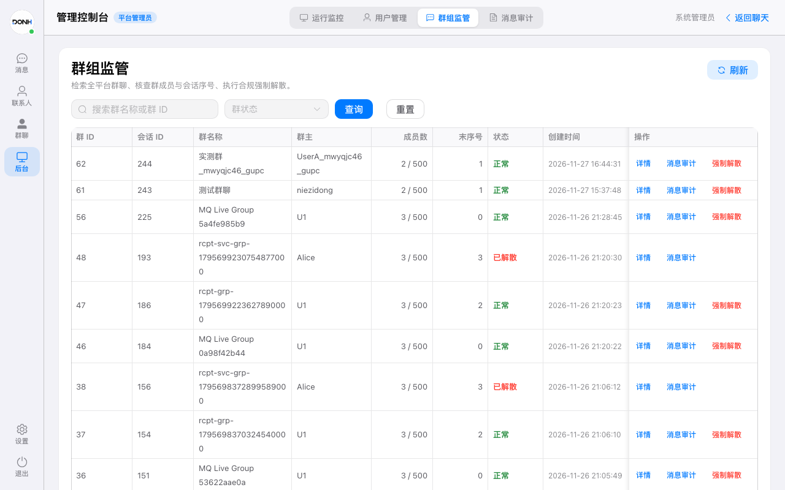

- **消息审计查询（`/admin/audit`）**：按会话 ID、发送者 ID、关键词与 UTC 时间范围组合检索不可变消息记录。

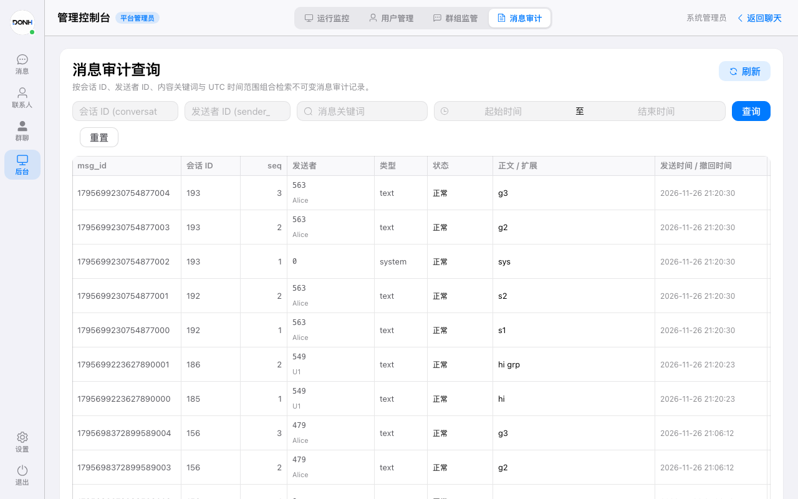

---

## 本地运行指南

前端通过 Vite 开发代理连接真实 Go 后端，运行完整系统需要同时启动 **MySQL 8.0**、**Redis 7**、**Go 后端** 与 **Vue 前端**。

### 1. 环境准备

- **Go**：1.22+（仓库 `backend/go.mod` 当前声明 `go 1.26.0`）
- **Node.js & npm**：建议 Node.js 20+ / 22+
- **MySQL 8.0** 与 **Redis 7**（可使用本机安装或 Docker 容器）

若使用 Docker 启动基础依赖，可参考如下方式拉起 MySQL 8.0 与 Redis 7（请自行替换口令占位符）：

```bash
docker run -d --name enterprise-im-mysql \
  -p 3306:3306 \
  -e MYSQL_ROOT_PASSWORD=<your_mysql_password> \
  -e MYSQL_DATABASE=enterprise_im \
  mysql:8.0

docker run -d --name enterprise-im-redis \
  -p 6379:6379 \
  redis:7 redis-server --requirepass <your_redis_password> --appendonly yes
```

### 2. 初始化数据库

将建表与默认种子脚本导入 MySQL 8.0（脚本会自动创建 `enterprise_im` 库及 12 张业务表，并写入本地开发管理员账号 `admin`）：

```bash
mysql -h 127.0.0.1 -P 3306 -u root -p < deploy/mysql/init.sql
```

> 默认本地开发管理员用户名为 `admin`，密码与前端 E2E 默认配置相同，详见 [frontend/e2e/helpers/env.ts](frontend/e2e/helpers/env.ts) 中的 `getAdminCredentials()`。请勿在生产环境使用默认测试口令。

### 3. 配置环境变量

后端默认读取 [backend/configs/config.yaml](backend/configs/config.yaml)，并支持通过环境变量覆盖敏感配置与运行参数。完整变量列表与默认值见 [.env.example](.env.example)。

运行前请在当前 Shell 中导出必要的敏感环境变量（切勿将真实密码或密钥提交到代码库）：

```bash
export MYSQL_HOST=127.0.0.1
export MYSQL_PORT=3306
export MYSQL_USER=root
export MYSQL_PASSWORD=<your_mysql_password>
export MYSQL_DATABASE=enterprise_im

export REDIS_ADDR=127.0.0.1:6379
export REDIS_PASSWORD=<your_redis_password>
export REDIS_DB=0

# 生产模式（APP_ENV=production）必须设置非占位符的 32 字节以上密钥
export JWT_SECRET=<replace-with-strong-random-secret>
```

### 4. 启动后端服务

```bash
# 方式一：使用 Makefile（默认监听 :8080）
make run

# 方式二：直接进入 backend 目录运行或构建
cd backend
go run ./cmd/server
# 或先编译：go build -o bin/enterprise-im-server ./cmd/server && ./bin/enterprise-im-server
```

验证后端与 MySQL/Redis 连通性：

```bash
curl -s http://127.0.0.1:8080/healthz
```

正常响应返回 HTTP 200 及 `"status":"ok","mysql":"ok","redis":"ok"`。

### 5. 启动前端应用

```bash
cd frontend
npm install
npm run dev
```

启动后在浏览器访问 `http://127.0.0.1:5173/`。Vite 默认通过 `frontend/vite.config.ts` 将 `/api`、`/uploads` 与 `/ws` 代理至 `IM_BACKEND_ORIGIN`（默认 `http://127.0.0.1:8080`）。

> 若需在隔离端口（如 `:8084` / `:5177`）快速拉起一套前后端联调栈，可参考并执行 [scripts/stage9-stack.sh](scripts/stage9-stack.sh)。

---

## 常用测试与校验命令

```bash
# 后端单元测试与竞态检测（依赖 live MySQL/Redis 的用例需先导出 MYSQL_PASSWORD / REDIS_PASSWORD）
make test
make test-race

# 前端类型检查与 Vitest 单元测试
cd frontend
npm run typecheck
npm test

# 前端 Playwright 端到端测试（需后端与前端均已启动）
npm run test:e2e
```

---

## 目录结构

```text
.
├── .env.example          # 环境变量模板（无真实密钥）
├── Makefile              # 后端构建、测试与运行快捷命令
├── PROGRESS.md           # 阶段开发进度与自检记录
├── PROJECT_GOALS.md      # 项目目标与一期技术基线规范
├── backend/              # Go + Gin 后端服务源码与测试
│   ├── cmd/server/       # 服务入口与优雅停机编排
│   ├── configs/          # 默认 YAML 配置
│   ├── internal/         # api / controller / service / repository / model / ws / mq / pkg
│   └── tests/            # 集成测试
├── deploy/mysql/         # MySQL 8.0 初始化建表脚本（init.sql）
├── docs/                 # 架构、API、ER 图、联调记录与界面截图
├── frontend/             # Vue 3 + TypeScript + Element Plus 客户端
│   ├── e2e/              # Playwright E2E 测试套件
│   ├── src/              # 页面视图、组件、Pinia Stores、Router 与 WSClient
│   └── tests/            # Vitest 单元测试
└── scripts/              # 联调启动脚本（stage9-stack.sh）
```

---

## 更多文档

- [系统架构与消息可靠性设计](docs/architecture.md)
- [REST API 与 WebSocket 协议文档](docs/api.md)
- [数据库设计与 ER 图](docs/er-diagram.md)
- [项目目标与技术方案基线](PROJECT_GOALS.md)
- [开发进度与阶段自检记录](PROGRESS.md)
- 第九阶段全链路联调记录：[社交与好友](docs/stage9/social.md) · [聊天与群组](docs/stage9/chat.md) · [断线重连补偿](docs/stage9/reconnect.md) · [管理后台与监管](docs/stage9/admin.md)
