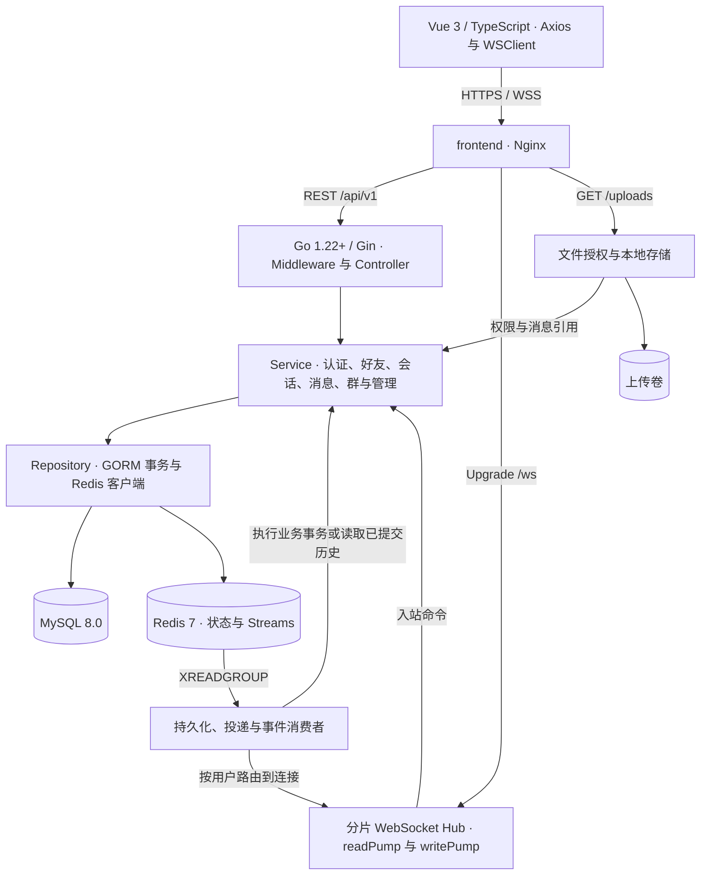
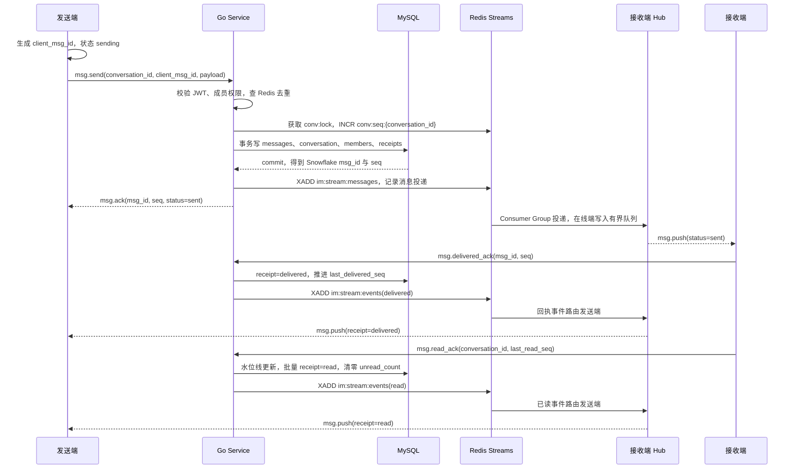

# 企业 IM 一期架构

一期通过同一个 Nginx 入口提供 Vue 客户端、REST、文件访问和 WebSocket。MySQL 保存用户关系、会话有序历史和回执。Redis 7 保存连接租约与序列计数，并用 Streams 把消息持久化、在线投递和故障重试串起来。客户端只有收到服务端持久化确认才能展示“已发送”。本设计遵循仓库的[目标规范](../PROJECT_GOALS.md)。

## 组件与数据流

| 边界 | 实现职责 |
| --- | --- |
| API / Router → Middleware → Controller | Gin 注册 HTTP、升级和健康检查路由。中间件处理 request_id、日志、恢复、CORS、JWT 与后台角色。Controller 绑定、校验、调用 Service、封装响应。 |
| Service → Repository → Model | Service 判断会话成员、群角色、状态迁移并控制 GORM 事务。Repository 使用事务句柄、索引查询和 Redis 原语。Model 映射基线的十张 InnoDB 表。HTTP、WS 与消费者共用同一组业务规则。 |
| WebSocket Hub | 使用 gorilla/websocket，按 user_id 分 64 片，各片的 sync.RWMutex 保护用户到多条连接的映射。连接身份绑定 user_id、session_id、device_id、node_id、conn_id。持锁取快照后释放，再向连接投递。 |
| 单条连接 | readPump 唯一读取，writePump 唯一写入帧并设置写期限。每端有容量 256 的有界发送队列。队满即注销慢端并触发重连补偿。注销按 conn_id 只执行一次，通过取消信号结束泵，避免向已关闭通道发送。 |
| Redis Streams 消费者 | 持久化组执行发送事务。各 Hub 的投递组将已提交的会话序列分发到本机连接，事件组分发回执、好友和群变更、撤回及下线。工作进程位于 backend 内。 |
| 上传与下载 | 后端在持久卷校验实际文件、生成 UUID 与元数据，图片生成缩略图，语音解析时长。原件、衍生图和服务端元数据在同一卷内就绪后才返回上传引用。历史消息只保存引用和展示元数据。 |

### 客户端与重连

Vue 3 使用 TypeScript、`<script setup>` Composition API、Vite、Element Plus、Vue Router、Axios 和 Pinia。`src/api/request.ts` 注入凭证，合并同一设备的刷新请求，成功后重放等候请求一次。`src/utils/wsClient.ts` 独占建连、心跳、订阅、退避和待确认队列。页面通过 Store 与 WSClient 交互。authStore、contactStore、conversationStore、messageStore、groupStore 分别维护登录态、联系人、会话摘要、按序历史和群成员。

桌面三栏依次为导航、会话列表、聊天区，窄屏按“列表 → 会话”切换。登录、注册、联系人、群管理与后台均有独立页面。聊天页拆分 ConversationList、ConversationItem、ChatHeader、MessageList、MessageBubble 和 MessageComposer。使用白、浅灰、深灰、近黑，颜色点明在线、未读与主操作，图标使用 @element-plus/icons-vue 线性图标，界面使用平面色块。

客户端持久化凭证、当前用户的活跃会话、逐会话连续的本地 last_seq 和未确认消息。更换账号时隔离这些数据。连接成功先订阅并暂存实时帧，再读取会话摘要、成员水位和每个会话的同步上界，拉取缺口后合并实时帧。主动刷新页面与断网重连使用同一路径。重连从 1 秒起指数退避，封顶 30 秒，每次在零至本次上限之间随机等待；重新鉴权成功后恢复心跳和原 ID 重发。

### 业务事务与访问范围

| 操作 | 必须一起生效的数据与对外结果 |
| --- | --- |
| 登录、刷新、退出、改密、禁用 | bcrypt 保存密码哈希。每个设备持有独立 user_sessions 记录、SHA-256 Refresh 摘要、当前 access_jti、过期时间和撤销时间。登录锁用户后替换同设备旧会话。刷新锁定会话并比较旧摘要，一次轮换两枚凭证。退出撤销指定范围；改密与禁用在同一事务中撤销该用户全部会话。禁用同时写 users.status。提交后关闭命中的连接，握手、REST 与入站业务命令都查当前用户和会话。 |
| 好友申请与处理 | 按用户 ID 升序锁定双方用户行，检查双向有效关系与任一方向待办申请。同意时更新 friend_requests，写入或恢复两条 friendships，以 min_id:max_id 的 direct_key 取得唯一单聊，创建或恢复两个 conversation_members，并追加一条 system 消息。拒绝只变更申请。删除将双向关系停用、双方会话隐藏；历史保留，原成员按 ID 可读，发送须恢复好友关系。备注只更新本人一侧。 |
| 群与成员 | 建群在同一事务写 groups、group_members、conversations 和 conversation_members，创建者为唯一 owner。邀请与移除同步两套成员记录，变更群公告、转让和解散写入有序 system 消息。群角色以 group_members 为准；容量含群主，默认 500。群主须先转让或解散才能退出。普通成员可改自己的群昵称。 |
| 群历史与退出 | 当前成员可翻阅该群历史。新成员水位以加入前已提交的会话末序号为基线，早期消息不计未读。移出或退出删除本届 group_members 记录并隐藏其会话，随即停止该用户的群历史、附件与实时正文权限。重新加入产生新的成员记录。解散保留当时成员及只读会话，最后一条 system 消息说明解散；该批成员可补拉及确认已读。 |
| 消息、撤回与回执 | 写消息同时更新 conversations.last_seq、last_msg_id、last_msg_at、last_msg_preview 和相关成员的未读数。单聊维护逐条 message_receipts，群以成员水位为主。撤回在同一事务改原消息、调整未读并追加有独立 seq 的撤回记录。回执、发送、撤回和成员变更按会话行串行化。 |
| 管理后台 | 独立校验 users.role=admin；群管理员只在该群有权限。用户禁用撤销全部设备，启用只恢复登录资格。后台强制解散调用同一群事务，审计按会话、发送者、关键词与时间组合过滤。 |

会话列表从 conversation_members 与 conversations 联表取得，用 IN 批量装配单聊对端、群资料和成员，用 Redis Pipeline 获取在线状态。好友、群成员与回执明细同样按页批量读取。消息历史与增量均走 (conversation_id, seq) 唯一索引。单聊引用 direct_key 唯一索引，群按 group_id 唯一取得会话。

## 消息可靠性与四阶段状态机

`client_msg_id` 由客户端用 UUID v4 或 ULID 生成，并在发送队列中保持不变。`msg_id` 由服务端 Snowflake 生成，`seq` 是一个会话内的严格递增游标。一次发送的状态只允许沿 `sending → sent → delivered → read` 前进，服务端依据当前状态幂等处理重复帧，不把 WebSocket 写成功当作送达。

| 状态 | 进入条件 | 服务端持久化与回帧 | 重试与终点 |
| --- | --- | --- | --- |
| `sending` | 客户端把完整请求放入本地队列。只在收到 `msg.ack` 后移除。 | 尚未产生服务端消息。客户端断线仍以原 `client_msg_id` 重发。 | 超过本地重试期限显示失败，用户可再次发送同一个或新建一个请求。 |
| `sent` | 服务端通过 JWT、成员、内容和附件引用校验，按 `(sender_id, client_msg_id)` 查 MySQL 唯一键和 Redis 去重。重复请求直接返回原 `msg_id`、`seq`、当前状态。 | 在一个 GORM 事务中分配 Snowflake、分配会话 `seq`、写 `messages`、更新会话摘要/未读和回执。事务提交后回 `msg.ack`，再 `XADD im:stream:messages`。 | Stream 生产或回帧失败不回滚已提交消息。重连先按 `seq` 补偿，消费者按 message_id 幂等。 |
| `delivered` | 接收端从 WS 队列或离线增量拿到 `msg.push` 后立即回 `msg.delivered_ack`。 | 按消息和接收者更新 `message_receipts`，只允许 `sent → delivered`，推进 `conversation_members.last_delivered_seq`，事件流通知发送端。 | 重复 ACK 只返回当前水位。离线端在补偿拉取后也要 ACK，服务端不会因在线状态猜测送达。 |
| `read` | 接收端打开会话并把可见范围的最大 seq 作为 `last_read_seq` 上报 WS 或 HTTP。 | 校验该用户是成员且目标 seq 不超过会话当前末 seq，单调更新 `last_read_seq`，批量把范围内自己的 receipts 标为 `read`，将未读清零并发已读事件。 | 较小或重复水位不回退。超过末 seq 的请求返回校验错误并不改库。 |

### seq、幂等与故障窗口

每次写入先 `SET conv:lock:{conversation_id} <token> NX PX 5000`，锁内检查 `MAX(seq)`，缺失时以 MySQL 最大值初始化 `conv:seq:{conversation_id}`，再执行 `INCR`。锁覆盖分配、MySQL 事务与提交结果处理。事务失败时使用带 token 的 Lua 脚本恢复旧值或删除刚初始化的 key。进程在提交后崩溃造成的悬空增量由下一次持锁操作以 MySQL `MAX(seq)` 校准，不能跳过一个已提交消息，也不会把未提交序号暴露给客户端。`uk_msg_conv_seq` 是最终约束，冲突时回源读取已存在消息并按幂等规则返回。

同一发送请求先查 `im:dedupe:{sender_id}:{client_msg_id}`。缓存值是 `msg_id|conversation_id|seq|status`，TTL 24 小时，写入使用 `SET NX`，并以 MySQL 唯一键作为永久事实。正在处理的短锁 `im:dedupe:lock:{sender_id}:{client_msg_id}` TTL 10 秒，异常过期后由下一次请求重新读取数据库。Snowflake 节点号必须在配置中唯一，时钟回拨由生成器暂停或拒绝，不复用已发出的 ID。

## Redis Key、Streams 与消费者规范

| Key 或命名 | 类型、TTL 与值 | 语义和写入边界 |
| --- | --- | --- |
| `im:presence:user:{user_id}` | String，TTL 75 秒，值为在线端数或最后心跳时间 | 任一端心跳续期。连接建立/关闭用计数脚本更新，只有计数为零且所有 session key 过期才广播离线。 |
| `im:presence:session:{session_id}` | Hash，TTL 75 秒，含 `user_id/device_id/node_id/conn_id/last_seen_at` | 每一条 WS 连接一个租约。刷新和注销都验证 session_id、conn_id，避免旧连接删除新连接。 |
| `im:route:user:{user_id}` | Set，TTL 90 秒，成员是 `node_id:conn_id` | 跨实例路由索引。节点注销只移除本连接，广播由目标节点过滤无效成员。 |
| `im:route:session:{session_id}` | String，TTL 90 秒，值为 `node_id:conn_id` | 将 Refresh 会话映射到 WS 连接，禁用或单端退出时用于精准踢除。 |
| `conv:seq:{conversation_id}` | String，无固定 TTL，非负整数 | 会话序列缓存。只在持有 `conv:lock:{conversation_id}` 时校准和递增，MySQL `MAX(seq)` 是恢复来源。 |
| `conv:lock:{conversation_id}` | String，PX 5000，随机 token | 串行化 seq 分配、消息事务和失败恢复。释放使用 token 校验 Lua。 |
| `im:dedupe:{sender_id}:{client_msg_id}` | String，TTL 24h，消息定位与状态 | 快速幂等命中，不能替代 MySQL 唯一约束。 |
| `im:dedupe:lock:{sender_id}:{client_msg_id}` | String，PX 10s | 同一客户端请求并发去重。过期即可重试，不保存正文。 |
| `im:token:blacklist:{jti}` | String，TTL 至 Access Token 到期，值为撤销原因 | 改密、退出、禁用和踢下线写入。每次 REST、WS 握手和入站帧检查。 |
| `im:stream:messages` | Redis Stream，按消息保留 7d 或长度上限 | 字段 `kind=message`、`message_id`、`conversation_id`、`seq`、`sender_id`、`payload_ref`。事务提交后 XADD，用于在线投递和离线补偿索引。 |
| `im:stream:events` | Redis Stream，按事件保留 7d 或长度上限 | 字段 `kind=delivered\|read\|presence\|friend\|group\|recall\|kick`、目标、会话和水位。用于通知和回执广播。 |
| `im:stream:dead:{messages\|events}` | Redis Stream，按月或人工审计保留 | 超过重试上限的完整事件引用、原 stream id、错误摘要、最后消费者。后台监控报警，人工修复后用原幂等键重放。 |
| `im:stream:pending:reclaim:{messages\|events}:{group}` | Hash，按日过期 | 记录最近一次 XAUTOCLAIM 起点、认领数、失败数和时间。它是可观测性游标，真正的 Pending 仍由 Redis PEL 维护。 |

固定 Consumer Group 如下。`im-msg-persist` 负责提交补偿，`im-msg-deliver` 负责消息投递，`im-event-deliver` 负责事件通知，`im-event-audit` 负责审计与监控。每个进程使用 `consumer={node_id}-{worker_id}`，不能共享同一 consumer 名称。

消费者调用 `XREADGROUP GROUP <group> <consumer> COUNT 100 BLOCK 2000 STREAMS <stream> >`。完成业务事务、更新回执或把帧成功放入目标 Hub 的有界队列后才 `XACK <stream> <group> <id>`。消费逻辑以 stream id 与业务唯一键幂等，重复消息不得重复未读或重复广播。工作线程每 30 秒用 `XAUTOCLAIM <stream> <group> reclaim-{node_id} 30000 0 COUNT 100` 认领超时 Pending，五次失败或超过 15 分钟写入 `im:stream:dead:*` 并 XACK 原条目。消费者恢复时先处理 Pending，再读 `>`，停机只停止领取新条目，遗留 PEL 由下一节点认领。`XTRIM MINID` 或 `MAXLEN ~` 只在消息已被全部业务保留策略覆盖后运行。

### 部署、生命周期与验收

`docker compose up -d --build` 是一键冷启动入口。mysql 使用 MySQL 8.0、utf8mb4、数据卷、初始化脚本 deploy/mysql/init.sql 与健康检查；redis 使用 Redis 7、AOF、数据卷与健康检查。backend 由 Go 多阶段镜像构建，等待两项健康检查通过，挂载 uploads/。frontend 在 Node 构建阶段产生 Vue 静态资源，由 Nginx 托管并支持前端路由回退，向后端反代 /api、/uploads 和带 Upgrade、Connection 头的 /ws。Nginx 读超时长于心跳失效期。

backend 从 config.yaml 读取配置，环境变量覆盖，开发与生产区分数据库连接、密钥、允许的 Origin、上传卷和 Snowflake 节点号。HTTP 与 WS 日志用 log/slog 记录 request_id、user_id、latency_ms、结果码，脱敏认证头及握手凭证。健康检查实际探测 MySQL 和 Redis；后台监控汇总有效租约、连接总数、最近一分钟提交消息数、各消费组 lag 与 Pending、Go Runtime 内存和 goroutine 数。

收到 SIGINT/SIGTERM 后停止接入新请求，向现有连接发停服通知并关闭，停止领取新任务，限时排空在途 HTTP 与消费者，最后关闭 MySQL 和 Redis。未确认的 Stream 条目留给下次认领。后续联调按注册、多端登录、互加好友、单群聊、媒体、撤回、重连、后台禁用的真实路径验收。压测使用 1000 个真实 WS 客户端，核对连续有序、零丢失、应用消息零重复和断开后两项在线计数归零；分片 Hub 另经 go test -race 检验。
