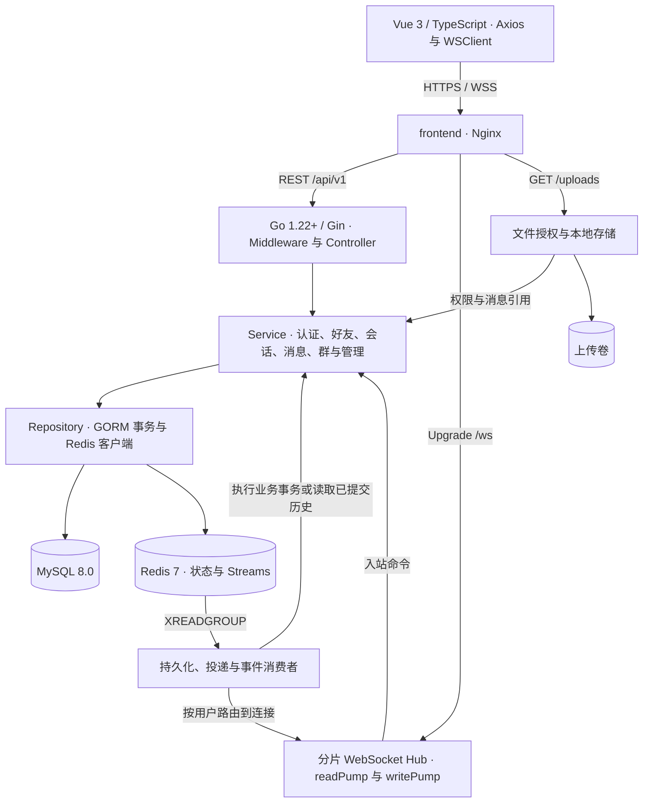

# 企业 IM 一期架构

一期通过同一个 Nginx 入口提供 Vue 客户端、REST、文件访问和 WebSocket。MySQL 保存用户关系、会话有序历史和回执。Redis 7 保存连接租约与序列计数，并用 Streams 把消息持久化、在线投递和故障重试串起来。客户端只有收到服务端持久化确认才能展示“已发送”。本设计遵循仓库的[目标规范](../PROJECT_GOALS.md)。

## 组件与数据流

| 边界 | 实现职责 |
| --- | --- |
| API / Router → Middleware → Controller | Gin 注册 HTTP、升级和健康检查路由。中间件处理 request_id、日志、恢复、CORS、JWT 与后台角色。Controller 绑定、校验、调用 Service、封装响应。 |
| Service → Repository → Model | Service 判断会话成员、群角色、状态迁移并控制 GORM 事务。Repository 使用事务句柄、索引查询和 Redis 原语。Model 映射基线的十张 InnoDB 表。HTTP、WS 与消费者共用同一组业务规则。 |
| WebSocket Hub | 使用 gorilla/websocket，按 user_id 分 64 片，各片的 sync.RWMutex 保护用户到多条连接的映射。连接身份绑定 user_id、session_id、device_id、node_id、conn_id。持锁取快照后释放，再向连接投递。 |
| 单条连接 | readPump 唯一读取，writePump 唯一写入帧并设置写期限。每端有容量 256 的有界发送队列。队满即注销慢端并触发重连补偿。注销按 conn_id 只执行一次，通过取消信号结束泵，避免向已关闭通道发送。 |
| Redis Streams 消费者 | 持久化组执行发送事务。各 Hub 的投递组将已提交的会话序列分发到本机连接，事件组分发回执、好友和群变更、撤回及下线。工作进程位于 backend 内。 |
| 上传与下载 | 后端在持久卷校验实际文件、生成 UUID 与元数据，图片生成缩略图，语音解析时长。原件、衍生图和服务端元数据在同一卷内就绪后才返回上传引用。历史消息只保存引用和展示元数据。 |

### 客户端与重连

Vue 3 使用 TypeScript、`<script setup>` Composition API、Vite、Element Plus、Vue Router、Axios 和 Pinia。`src/api/request.ts` 注入凭证，合并同一设备的刷新请求，成功后重放等候请求一次。`src/utils/wsClient.ts` 独占建连、心跳、订阅、退避和待确认队列。页面通过 Store 与 WSClient 交互。authStore、contactStore、conversationStore、messageStore、groupStore 分别维护登录态、联系人、会话摘要、按序历史和群成员。

桌面三栏依次为导航、会话列表、聊天区，窄屏按“列表 → 会话”切换。登录、注册、联系人、群管理与后台均有独立页面。聊天页拆分 ConversationList、ConversationItem、ChatHeader、MessageList、MessageBubble 和 MessageComposer。使用白、浅灰、深灰、近黑，颜色点明在线、未读与主操作，图标使用 @element-plus/icons-vue 线性图标，界面使用平面色块。

客户端持久化凭证、当前用户的活跃会话、逐会话连续的本地 last_seq 和未确认消息。更换账号时隔离这些数据。连接成功先订阅并暂存实时帧，再读取会话摘要、成员水位和每个会话的同步上界，拉取缺口后合并实时帧。主动刷新页面与断网重连使用同一路径。重连从 1 秒起指数退避，封顶 30 秒，每次在零至本次上限之间随机等待；重新鉴权成功后恢复心跳和原 ID 重发。

### 业务事务与访问范围

| 操作 | 必须一起生效的数据与对外结果 |
| --- | --- |
| 登录、刷新、退出、改密、禁用 | bcrypt 保存密码哈希。每个设备持有独立 user_sessions 记录、SHA-256 Refresh 摘要、当前 access_jti、过期时间和撤销时间。登录锁用户后替换同设备旧会话。刷新锁定会话并比较旧摘要，一次轮换两枚凭证。退出撤销指定范围；改密与禁用在同一事务中撤销该用户全部会话。禁用同时写 users.status。提交后关闭命中的连接，握手、REST 与入站业务命令都查当前用户和会话。 |
| 好友申请与处理 | 按用户 ID 升序锁定双方用户行，检查双向有效关系与任一方向待办申请。同意时更新 friend_requests，写入或恢复两条 friendships，以 min_id:max_id 的 direct_key 取得唯一单聊，创建或恢复两个 conversation_members，并追加一条 system 消息。拒绝只变更申请。删除将双向关系停用、双方会话隐藏；历史保留，原成员按 ID 可读，发送须恢复好友关系。备注只更新本人一侧。 |
| 群与成员 | 建群在同一事务写 groups、group_members、conversations 和 conversation_members，创建者为唯一 owner。邀请与移除同步两套成员记录，变更群公告、转让和解散写入有序 system 消息。群角色以 group_members 为准；容量含群主，默认 500。群主须先转让或解散才能退出。普通成员可改自己的群昵称。 |
| 群历史与退出 | 当前成员可翻阅该群历史。新成员水位以加入前已提交的会话末序号为基线，早期消息不计未读。移出或退出删除本届 group_members 记录并隐藏其会话，随即停止该用户的群历史、附件与实时正文权限。重新加入产生新的成员记录。解散保留当时成员及只读会话，最后一条 system 消息说明解散；该批成员可补拉及确认已读。 |
| 消息、撤回与回执 | 写消息同时更新 conversations.last_seq、last_msg_id、last_msg_at、last_msg_preview 和相关成员的未读数。单聊维护逐条 message_receipts，群以成员水位为主。撤回在同一事务改原消息、调整未读并追加有独立 seq 的撤回记录。回执、发送、撤回和成员变更按会话行串行化。 |
| 管理后台 | 独立校验 users.role=admin；群管理员只在该群有权限。用户禁用撤销全部设备，启用只恢复登录资格。后台强制解散调用同一群事务，审计按会话、发送者、关键词与时间组合过滤。 |

会话列表从 conversation_members 与 conversations 联表取得，用 IN 批量装配单聊对端、群资料和成员，用 Redis Pipeline 获取在线状态。好友、群成员与回执明细同样按页批量读取。消息历史与增量均走 (conversation_id, seq) 唯一索引。单聊引用 direct_key 唯一索引，群按 group_id 唯一取得会话。

### 部署、生命周期与验收

`docker compose up -d --build` 是一键冷启动入口。mysql 使用 MySQL 8.0、utf8mb4、数据卷、初始化脚本 deploy/mysql/init.sql 与健康检查；redis 使用 Redis 7、AOF、数据卷与健康检查。backend 由 Go 多阶段镜像构建，等待两项健康检查通过，挂载 uploads/。frontend 在 Node 构建阶段产生 Vue 静态资源，由 Nginx 托管并支持前端路由回退，向后端反代 /api、/uploads 和带 Upgrade、Connection 头的 /ws。Nginx 读超时长于心跳失效期。

backend 从 config.yaml 读取配置，环境变量覆盖，开发与生产区分数据库连接、密钥、允许的 Origin、上传卷和 Snowflake 节点号。HTTP 与 WS 日志用 log/slog 记录 request_id、user_id、latency_ms、结果码，脱敏认证头及握手凭证。健康检查实际探测 MySQL 和 Redis；后台监控汇总有效租约、连接总数、最近一分钟提交消息数、各消费组 lag 与 Pending、Go Runtime 内存和 goroutine 数。

收到 SIGINT/SIGTERM 后停止接入新请求，向现有连接发停服通知并关闭，停止领取新任务，限时排空在途 HTTP 与消费者，最后关闭 MySQL 和 Redis。未确认的 Stream 条目留给下次认领。后续联调按注册、多端登录、互加好友、单群聊、媒体、撤回、重连、后台禁用的真实路径验收。压测使用 1000 个真实 WS 客户端，核对连续有序、零丢失、应用消息零重复和断开后两项在线计数归零；分片 Hub 另经 go test -race 检验。
