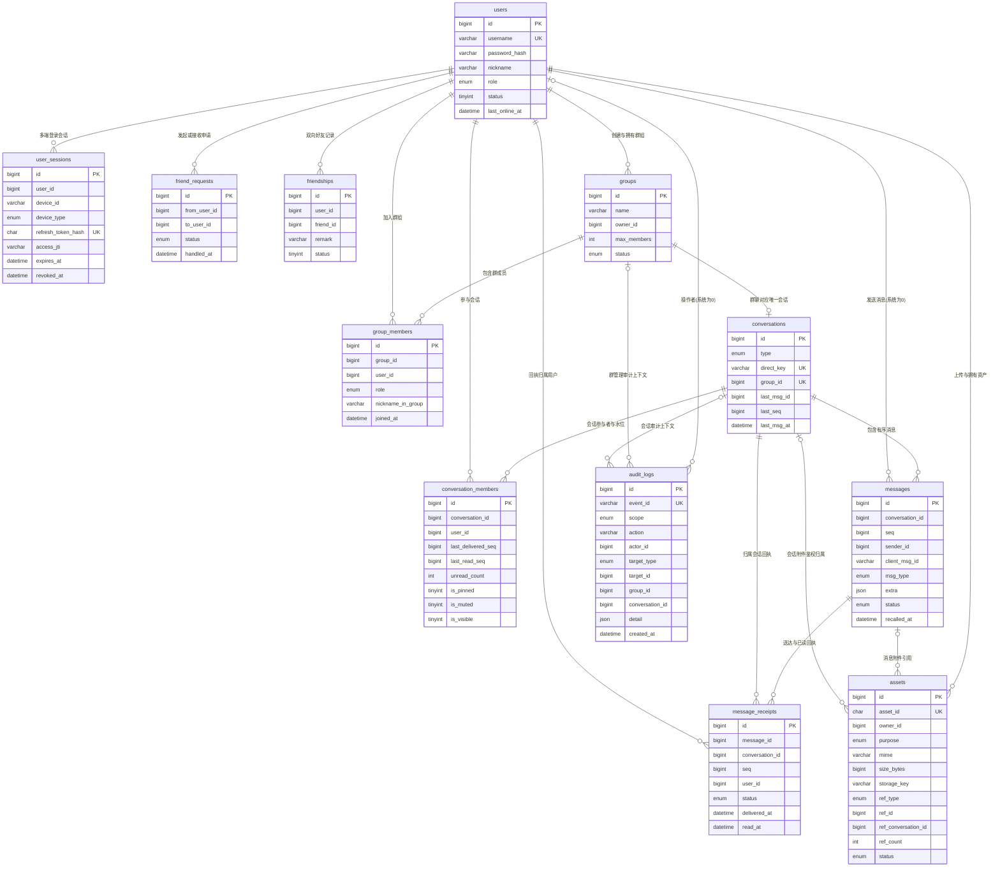

# Enterprise IM 数据库设计与 ER 图

本文档是 [PROJECT_GOALS.md](../PROJECT_GOALS.md) 第六章数据库基线、[架构设计](architecture.md) 与 [接口契约](api.md) 在第二阶段的完整数据库实现说明，对应初始化脚本 [deploy/mysql/init.sql](../deploy/mysql/init.sql)。

---

## 一、库级规范与全局约束

| 项目 | 约定值 | 说明 |
| --- | --- | --- |
| 数据库名 | `enterprise_im` | Docker Compose 空数据卷由 `init.sql` 自动初始化 |
| 存储引擎 | `InnoDB` | 全部 12 张表统一启用事务与行级锁支持 |
| 字符集 / 排序规则 | `utf8mb4` / `utf8mb4_0900_ai_ci` | 原生兼容 Emoji 与多语言昵称、群名、消息正文 |
| 时间字段精度 | `DATETIME(3)` | 毫秒级时间精度，与 API 层 UTC RFC 3339 毫秒约定对齐 |
| 外部主键传递 | 十进制字符串 | 数据库存储 `BIGINT UNSIGNED`，REST/WS 传输统一转十进制字符串防 JS 精度丢失 |
| 物理外键策略 | 不使用 DDL `FOREIGN KEY` | 遵循 `PROJECT_GOALS.md` §六.3，规避 Snowflake 并发写锁竞争、`sender_id=0`/`actor_id=0` 系统事件及未来按 `conversation_id` 分表或按月冷热归档阻力；引用完整性由 GORM 事务、按序加锁与唯一索引保障 |

### 12 张表总览

- **核心业务十表（严格对齐 `PROJECT_GOALS.md` §六.3）**：`users`、`user_sessions`、`friend_requests`、`friendships`、`groups`、`group_members`、`conversations`、`conversation_members`、`messages`、`message_receipts`
- **第二阶段支撑表（对齐 `docs/architecture.md` 与 `docs/api.md` 冻结契约）**：`assets`、`audit_logs`

---

## 二、全局 ER 图（12 张表）

---

## 三、三个核心 ID 的职责边界

| 字段 | 生成方 | 唯一性与有序性 | 核心职责与约束 |
| --- | --- | --- | --- |
| `client_msg_id` | 客户端（UUID v4 / ULID） | 发送者维度唯一 | 1. 客户端本地 `sending` 占位与 `msg.ack` 匹配关联 2. 断线重发保持不变，结合 `UNIQUE(sender_id, client_msg_id)` 与 Redis `im:dedupe:{sender_id}:{client_msg_id}` 实现服务端严格幂等去重；内容不一致重用返回错误码 `14001` |
| `id` (`msg_id`) | 服务端（Snowflake） | 全局唯一、大致趋势递增 | 1. `messages` 非自增全局主键（无自增锁争用，支持后续分表/归档） 2. 作为 `message_receipts.message_id`、撤回 `extra` 引用与消息审计定位键 |
| `seq` | 服务端（Redis `conv:lock` + `INCR`） | **同一 `conversation_id` 内严格连续递增** | 1. 保证多端展示顺序绝对一致，通过 `UNIQUE(conversation_id, seq)` 最终兜底 2. 支撑 `seq < before_seq` 历史游标分页与 `seq > after_seq` 离线增量拉取 3. 支撑 `last_delivered_seq` / `last_read_seq` 水位线推进与未读计数；`recall` 记录也分配独立 `seq` |

---

## 四、表结构、约束与索引明细

### 1. `users`（用户表）

- **职责**：账号主体信息、角色与启用状态（统一 `1` 正常 / `0` 禁用）。
- **主键与索引**：
  - `PRIMARY KEY (id)`（自增 `BIGINT UNSIGNED`）
  - `UNIQUE KEY uk_users_username (username)`：登录名唯一性与精确查询
  - `KEY idx_users_nickname (nickname)`：支持按昵称精确与前缀模糊搜索（`LIKE 'prefix%'`）
  - `KEY idx_users_status_created (status, created_at)`：后台用户筛选与分页
- **关键约束**：`password_hash` 存储真实 `bcrypt` 哈希（cost≥10）；`role` 枚举 `('user','admin')`；`status` 约定 `1` 启用、`0` 禁用；`last_online_at` 仅在全部连接租约归零时刷新。

### 2. `user_sessions`（用户多端登录会话表）

- **职责**：维护多终端（`web` / `desktop` / `mobile`）登录会话、Refresh Token 轮换与单端/全端吊销。
- **主键与索引**：
  - `PRIMARY KEY (id)`
  - `UNIQUE KEY uk_sessions_refresh_hash (refresh_token_hash)`：按 Refresh Token SHA-256 摘要 `CHAR(64)` 快速定位并防重复消费
  - `KEY idx_sessions_user_device (user_id, device_id)`：同设备重新登录时锁定并替换旧会话
  - `KEY idx_sessions_user_revoked_exp (user_id, revoked_at, expires_at)`：查询用户当前有效会话数、踢下线及超限校验（`11009`）
- **关键约束**：服务端不保存 Refresh 明文；同一 `session_id` 允许浏览器多标签页并发建连（路由由 Redis Set `im:route:session:{session_id}` 承担），单端退出/改密/禁用会设置 `revoked_at` 并拉黑 `access_jti`。

### 3. `friend_requests`（好友申请记录表）

- **职责**：记录好友验证申请及状态流转（`pending` / `accepted` / `rejected` / `canceled`）。
- **主键与索引**：
  - `PRIMARY KEY (id)`
  - `KEY idx_fr_to_status_created (to_user_id, status, created_at DESC)`：收到的申请列表按状态筛选与时间倒序分页
  - `KEY idx_fr_from_to_status (from_user_id, to_user_id, status)`：双向防重检查与发出的申请查询
- **关键约束**：发起申请及同意申请事务按用户 ID 升序锁定双方 `users` 行，校验双向均无 `pending` 申请且当前非有效好友。

### 4. `friendships`（好友关系表）

- **职责**：采用双向两条记录建模好友关系，支持双方各自维护 `remark` 备注并避免 `OR` 全表扫描。
- **主键与索引**：
  - `PRIMARY KEY (id)`
  - `UNIQUE KEY uk_friendships_pair (user_id, friend_id)`：确保单向关系唯一，重新加好友时就地恢复 `status=1`
  - `KEY idx_friendships_user_status (user_id, status)`：拉取本人有效好友列表
  - `KEY idx_friendships_friend_status (friend_id, status)`：在线状态变更推送与反向关系检查
- **关键约束**：删除好友将双向记录 `status` 置为 `0` 并隐藏对应单聊会话，不物理删除历史消息。

### 5. `groups`（群组表）

- **职责**：存储群基础资料、群主归属、人数上限（默认 `500`）与生命周期状态（`active` / `disbanded`）。
- **主键与索引**：
  - `PRIMARY KEY (id)`
  - `KEY idx_groups_owner (owner_id)`：按群主检索名下群组
  - `KEY idx_groups_status_created (status, created_at DESC)`：后台群管理筛选与时间倒序分页
- **关键约束**：`max_members` 默认 `500`（含群主），建群/拉人必须在事务内检查成员上限；解散时置 `status='disbanded'` 并写入 `system` 消息。

### 6. `group_members`（群成员表）

- **职责**：维护群内角色（`owner` / `admin` / `member`）与群昵称。
- **主键与索引**：
  - `PRIMARY KEY (id)`
  - `UNIQUE KEY uk_gm_group_user (group_id, user_id)`：防重复入群，校验群权限唯一依据
  - `KEY idx_gm_user_group (user_id, group_id)`：查询用户加入的全部群聊
- **关键约束**：群主不可直接退出，须先转让群主或解散群；移出/退出删除当前 `group_members` 记录（重新加入产生新记录，并更新 `conversation_members.joined_at` 与水位基线）。

### 7. `conversations`（会话表）

- **职责**：统一抽象单聊（`single`）与群聊（`group`）会话元数据及最新消息摘要。
- **主键与索引**：
  - `PRIMARY KEY (id)`
  - `UNIQUE KEY uk_conv_direct_key (direct_key)`：单聊唯一键 `min(u1,u2):max(u1,u2)`，群聊为 `NULL`（MySQL 唯一索引允许多个 `NULL`）
  - `UNIQUE KEY uk_conv_group_id (group_id)`：群聊关联唯一 `groups.id`，单聊为 `NULL`
  - `KEY idx_conv_last_msg_at (last_msg_at DESC)`：按最近活跃时间查询
- **关键约束**：`last_seq` 与 `last_msg_id` / `last_msg_preview` / `last_msg_at` 随消息及撤回主事务同步更新；服务端写前按会话行串行化。

### 8. `conversation_members`（会话成员表）

- **职责**：承载用户维度的会话列表可见性、置顶/免打扰偏好、未读计数及四阶段状态机的送达/已读水位线。
- **主键与索引**：
  - `PRIMARY KEY (id)`
  - `UNIQUE KEY uk_cm_conv_user (conversation_id, user_id)`：成员资格与水位唯一记录
  - `KEY idx_cm_user_visible_updated (user_id, is_visible, is_pinned DESC, updated_at DESC)`：会话列表核心覆盖排序索引
- **关键约束**：`last_delivered_seq` 与 `last_read_seq` 仅允许单调递增且不得超过 `conversations.last_seq`；被移出/退出群聊时隐藏会话并终止群历史与附件访问；群解散时保留当时成员的只读成员记录以便补拉与确认已读。

### 9. `messages`（消息表）

- **职责**：全量会话有序消息事实表，支持 `text`、`image`、`file`、`voice`、`recall`、`system` 六类消息。
- **主键与索引**：
  - `PRIMARY KEY (id)`：服务端 Snowflake 生成，**非自增**
  - `UNIQUE KEY uk_msg_conv_seq (conversation_id, seq)`：同一会话内 `seq` 唯一约束与历史/增量游标主索引
  - `UNIQUE KEY uk_msg_sender_client (sender_id, client_msg_id)`：发送幂等最终防线
  - `KEY idx_msg_conv_created (conversation_id, created_at DESC)`：后台按会话与时间范围审计检索
  - `KEY idx_msg_sender_created (sender_id, created_at DESC)`：后台按发送者与时间范围审计检索
- **关键约束**：`sender_id=0` 表示系统产生消息；撤回消息将原消息 `status` 置为 `recalled` 并记录 `recalled_at`，同时追加一条独立 `seq` 的 `msg_type='recall'` 消息记录。

### 10. `message_receipts`（消息送达和已读回执表）

- **职责**：记录接收方对消息的四阶段推进状态（`sent` → `delivered` → `read`）及精确送达/已读时间戳。
- **主键与索引**：
  - `PRIMARY KEY (id)`
  - `UNIQUE KEY uk_receipt_msg_user (message_id, user_id)`：每条消息每个接收者一条回执，保证 `delivered_ack` / `read_ack` 幂等
  - `KEY idx_receipt_conv_user_seq (conversation_id, user_id, seq)`：按 `last_read_seq` 批量将区间内未读回执推进为 `read`
  - `KEY idx_receipt_conv_user_status (conversation_id, user_id, status)`：按状态查询未送达/未读回执
- **关键约束**：单聊主事务同步写入接收方初始回执；大群聊以 `conversation_members` 水位线为主，避免大群每条消息写入数百行引发写放大。

### 11. `assets`（上传资产表 —— 第二阶段支撑表）

- **职责**：持久化 `/api/v1/uploads` 与 `/api/v1/me/avatar` 上传文件的真实媒体元数据、内部相对存储键及业务引用关系，支撑受权下载校验与「已被消息引用禁止删除（错误码 `16006`）」。
- **字段亮点**：
  - `asset_id CHAR(36)`：上传服务生成的对外 UUID
  - `owner_id`、`purpose`（`image | file | voice | avatar | group_avatar`）、`filename`、`mime`、`size_bytes`、`sha256`
  - 媒体扩展：`width`、`height`、`duration_ms`、`thumbnail_key`、`thumbnail_mime`、`thumbnail_size_bytes`
  - 存储隔离：`storage_key` 与 `thumbnail_key` 仅存相对逻辑键，**严禁作为对外 API 字段或直接暴露宿主机磁盘路径**
  - 引用与权限模型：`ref_type`（`none | message | user_avatar | group_avatar`）、`ref_id`、`ref_conversation_id`、`ref_count`、`bound_at`、`status`（`active | deleted`）、`deleted_at`
- **主键与索引**：
  - `PRIMARY KEY (id)`
  - `UNIQUE KEY uk_assets_asset_id (asset_id)`：REST `/uploads/{asset_id}` 与消息 `extra.asset_id` 关联主键
  - `KEY idx_assets_owner_status_created (owner_id, status, created_at DESC)`：查询用户上传资产及属主校验
  - `KEY idx_assets_ref (ref_type, ref_id)`：反查消息、用户头像或群头像关联资产
  - `KEY idx_assets_ref_conv (ref_conversation_id)`：下载鉴权时结合 `conversation_members` / `group_members` 校验当前成员资格
  - `KEY idx_assets_status_ref_created (status, ref_type, created_at)`：定时清理超时未引用的孤儿临时资产
- **权限与删除不变式**：
  - 刚上传未绑定时（`ref_type='none'`），仅 `owner_id` 可读取或删除，其他用户读取返回 `16004`；
  - 绑定到消息（`ref_type='message'`）或头像/群头像（`user_avatar` / `group_avatar`）后，按对应会话成员或认证用户规则开放受权访问；
  - 调用 `DELETE /api/v1/uploads/{asset_id}` 时，若 `ref_type='message'` 且 `ref_count > 0`，服务端拒绝删除并返回 `16006`。

### 12. `audit_logs`（不可变审计日志表 —— 第二阶段支撑表）

- **职责**：持久化平台管理后台操作与群管理不可变审计事件，支撑 `GET /api/v1/groups/{group_id}/audit`、管理员用户/群详情审计摘要与后台操作审计查询；由业务事务与 Redis Streams `im:stream:events` / `im-event-audit` 消费组异步幂等落库。
- **append-only 约束**：表设计刻意**不包含 `updated_at` 与 `deleted_at`**，且业务层与消费者**只允许 `INSERT`，严禁执行 `UPDATE` 或 `DELETE`**。
- **字段覆盖**：`event_id`（幂等去重键）、`scope`（`admin | group | system`）、`action`、`actor_id`、`actor_role`、`target_type`（`user | session | group | conversation | message | asset | system`）、`target_id`、`group_id`、`conversation_id`、`reason`、`detail`（JSON 结构化上下文）、`request_id`、`ip_address`、`user_agent`、`created_at`。
- **主键与索引**：
  - `PRIMARY KEY (id)`：append-only 顺序游标分页键
  - `UNIQUE KEY uk_audit_event_id (event_id)`：保证 `im-event-audit` 消费重试或 `XAUTOCLAIM` 认领时不重复落库
  - `KEY idx_audit_group_created (group_id, created_at DESC, id DESC)`：精确支撑 `GET /api/v1/groups/{group_id}/audit` 按群与时间窗口分页
  - `KEY idx_audit_scope_action_created (scope, action, created_at DESC)`：后台按审计域、动作与时间过滤
  - `KEY idx_audit_actor_created (actor_id, created_at DESC)`：按操作者追溯操作记录
  - `KEY idx_audit_target_created (target_type, target_id, created_at DESC)`：按目标用户/群/消息检索审计摘要
  - `KEY idx_audit_conv_created (conversation_id, created_at DESC)`：按会话维度过滤审计事件

---

## 五、查询优化与数据增长演进策略（对齐 `PROJECT_GOALS.md` §六.4）

1. **游标分页杜绝 `OFFSET` 深分页**：历史消息一律使用 `WHERE conversation_id = ? AND seq < ? ORDER BY seq DESC LIMIT ?`，直接命中 `uk_msg_conv_seq` 唯一索引，避免百万级消息表在翻页深度增加后出现全索引扫描退化。
2. **断线离线补偿拉取**：重连后基于 `WHERE conversation_id = ? AND seq > ? ORDER BY seq ASC LIMIT ?` 顺序增量拉取，按客户端各会话 `last_seq` 精确补齐缺口。
3. **防 N+1 批量装配**：会话列表先查询本人 `conversation_members` JOIN `conversations`，收集对端 `user_id` 与 `group_id` 切片后单次 `IN (...)` 批量查询 `users` / `groups` / `friendships`，在线状态通过 Redis Pipeline 一次拼装。
4. **群聊回执写放大控制**：单聊维护逐条 `message_receipts` 并同步推进 `conversation_members` 水位；群聊以 `conversation_members.last_delivered_seq` / `last_read_seq` 水位线为默认路径，`GET /messages/{msg_id}/receipts` 按需基于成员水位聚合分页返回已读/未读明细。
5. **分表与冷热归档预留**：`messages` 与 `message_receipts` 均以 `conversation_id` 为核心索引前导列，且 `messages.id` 采用内含时间戳的 Snowflake 算法，可平滑演进为按 `conversation_id` 哈希分表或按 `created_at` 按月归档；`audit_logs` 按 `created_at` 天然支持只追加的月度归档或分区裁剪。

---

## 六、默认本地开发管理员种子说明

`deploy/mysql/init.sql` 末尾通过幂等 `INSERT IGNORE INTO users` 写入了一条默认平台管理员记录，**仅用于本地开发与后续联调验证，并非生产环境密钥**：

| 字段 | 默认值 | 说明 |
| --- | --- | --- |
| `username` | `admin` | 平台管理员登录用户名 |
| 初始口令（明文仅文档说明） | `Admin@123456` | 12 字节 UTF-8 字符串，满足 API 8–72 字节密码限制 |
| `password_hash` | `$2a$10$8uLi1z7yKc9N28SrYAXW1uRurpmO9uk66JQjVxSE1Z8bSAtcbeE82` | 本地 `bcrypt`（cost=10，`$2a$` 前缀）实算结果，可与 `golang.org/x/crypto/bcrypt` 兼容校验 |
| `role` | `admin` | 平台管理员角色，允许访问 `/api/v1/admin/*` |
| `status` | `1` | 启用状态 |

> **安全提示**：任何正式或公网环境部署前必须立即修改管理员密码；仓库及进度报告中严禁记录 MySQL 连接凭证或其他运行时密钥。
